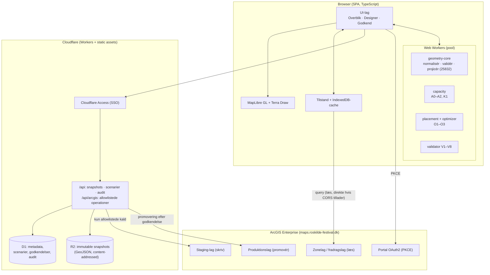
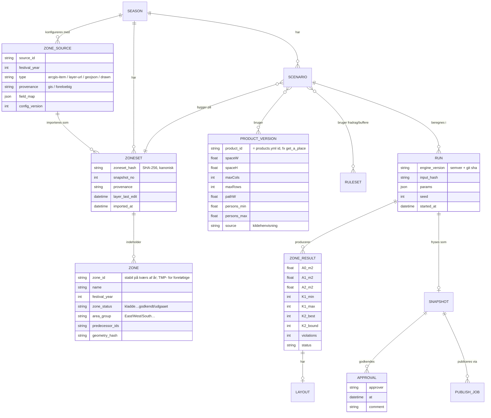
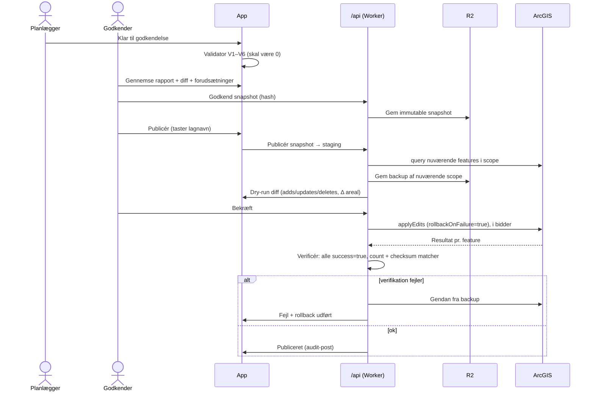

# Discovery 5 — Arkitektur, sikkerhed og dataintegritet

> Status: discovery · Dato: 2026-11-07
> Princip: **undgå unødig kompleksitet.** Hver komponent skal begrundes i et konkret behov fra [Geometri](DISCOVERY-GEOMETRY-AND-CAPACITY.md), [Optimering](DISCOVERY-OPTIMIZATION.md) eller [UX](DISCOVERY-UX-CONCEPTS.md).

## 1. Målbillede i én figur

## 2. Teknologivalg — sammenligning og anbefaling

### 2.1 Frontend

| Mulighed | For | Imod | Vurdering |
|---|---|---|---|
| Behold én `index.html`, vanilla JS | Nul byggetrin, nem deploy | Ingen typer, moduler eller tests. Kan ikke rumme tre arbejdsrum, scenarier og workers uden at blive uoverskuelig | Kun til hotfixes (fase 0) |
| Vite + TypeScript + vanilla/Lit | Let, hurtigt, typer | Tabeller, paneler og tilstand skal håndbygges | Realistisk, hvis UI'et holdes lille |
| **Vite + TypeScript + React** | Moden økosystem (react-map-gl til MapLibre, TanStack Table), let at finde hjælp og vedligeholde | Større bundle og mere ceremoni | **Anbefalet** pga. UI-kompleksiteten i [UX](DISCOVERY-UX-CONCEPTS.md) |
| Vite + TypeScript + Svelte 5 / Preact | Lettere end React, god DX | Mindre økosystem til GIS-UI | Ligeværdigt alternativ, hvis teamet foretrækker det |
| Next.js / SSR-framework | — | Intet behov for SSR. Statisk SPA + Worker-API er nok | Fravælges |

**Uanset UI-valg:** domænelogikken (geometri, kapacitet, placering, validator) skrives som et **framework-uafhængigt TypeScript-modul** (`packages/engine`) uden DOM-afhængigheder. Det kan køre i browser, worker, Node (benchmark og tests) og eventuelt Cloudflare Worker.

### 2.2 Kort og tegning

| Mulighed | For | Imod | Vurdering |
|---|---|---|---|
| Leaflet 1.9 + Leaflet.draw | Kendt og kører i dag | Leaflet.draw er uvedligeholdt siden 2018. Raster/canvas med ét JS-objekt pr. plads skalerer dårligt. Ingen feature-state-styling | Udfases |
| **MapLibre GL JS** (v5) | WebGL-rendering af titusinder af polygoner, datadrevet styling og `feature-state` til hover/valg uden genopbygning, vektor + raster, glatte overgange, open source | Større API-flade, WebGL-krav | **Anbefalet** |
| ArcGIS Maps SDK for JavaScript | Native ArcGIS-auth, editering, projektion og geometrioperatorer i ét | Tungt (flere MB), tæt bundet til Esri, mindre fleksibelt UI | Seriøst alternativ, *hvis* Team GIS ønsker fuld Esri-konsistens. Afklares med GIS (U5) |
| Tegning: **Terra Draw** | Adapter-baseret (MapLibre, Leaflet, OpenLayers m.fl.), aktivt vedligeholdt, polygon/linje/punkt/select/redigér | — | **Anbefalet** |

Hypotese **H4**: MapLibre renderer 30.000 pladspolygoner med hover og valg ved ≥ 50 fps på en standardlaptop, hvor Leaflet-canvas med 30.000 objekter ikke gør.

### 2.3 Geometri

| Behov | Anbefaling | Begrundelse |
|---|---|---|
| Union, intersection, difference | **Turf 7** (`polyclip-ts`) | Robuste boolske operationer. Turf 6.5's operationer er mindre robuste ved næsten-sammenfaldende kanter |
| Projektion | **proj4js**, EPSG:25832 som beregnings-CRS | Se [Geometri §8](DISCOVERY-GEOMETRY-AND-CAPACITY.md) |
| Validering / makeValid / buffer | **JSTS** (JTS-port) eller GEOS via WASM (`geos-wasm`) | Begge har modne buffer- og validitetsalgoritmer. Valget afgøres af bundlestørrelse og målt robusthed (H6) |
| Spatialt indeks | `flatbush` / `rbush` | Validator V3 (parvist overlap) og hurtig hit-test |
| Placering | Egen kode i `packages/engine` | Domænespecifik. Den eksisterende kerne porteres og testes mod benchmark |
| Eksakt orakel | OR-Tools CP-SAT (Python, offline) eller HiGHS (WASM) | Kun benchmark, ikke runtime (se [Optimering §5](DISCOVERY-OPTIMIZATION.md)) |

**Præcision:** al beregning sker i meter (EPSG:25832) med koordinater snappet til 1 cm før boolske operationer. Konvertering til WGS84 sker kun ved rendering og GeoJSON-eksport.

### 2.4 Web Workers

- En workerpool (`navigator.hardwareConcurrency − 1`) med Comlink som RPC.
- Optimering parallelliseres pr. zone og pr. vinkelkandidat. Fremdrift streames til UI'et, og alle jobs kan annulleres.
- Deterministiske resultater: samme input-hash + motorversion + seed giver samme output. Det er forudsætningen for reproducerbare snapshots.
- Målt: den nuværende søgning tager 0,67 s for én 25 ha-zone, og en god søgning 6–9 s for en uregelmæssig zone. Med 8 kerner og 40 zoner er et fuldt site realistisk på under ét minut i baggrunden. Det er et estimat; verificeres i H1.

### 2.5 Dataimport og caching

| Kilde | Metode |
|---|---|
| Zonekilde pr. festivalår | Konfiguration (item-ID/lag-URL, `where`, feltmapping) uden kodeændring; se [Zoneintegration §2](DISCOVERY-ZONE-INTEGRATION.md) |
| ArcGIS zonelag og fradragslag | REST `query` med `f=json&outSR=25832`, paging (`resultOffset`/`resultRecordCount`), `where` og `outFields`. Esri JSON konverteres med `@terraformer/arcgis`. Erstatter esri-leaflets udsnitsbaserede indlæsning (fejl F13) |
| Ændringsdetektion | Lagets `editingInfo.lastEditDate`. Uændret lag betyder brug af cache |
| Filimport | Træk-og-slip af GeoJSON (og evt. Shapefile/GeoPackage senere) |
| Cache | IndexedDB nøglet på `(lag-URL, lastEditDate)` og input-hash. Gør appen brugbar offline og genindlæsning øjeblikkelig |
| ArcGIS-klient | `@esri/arcgis-rest-request` + `@esri/arcgis-rest-feature-service`: små, typede, med `ArcGISIdentityManager` (PKCE, refresh). Erstatter hjemmebygget OAuth og esri-leaflet |

### 2.6 Drift på Cloudflare

| Emne | I dag | Forslag |
|---|---|---|
| Hosting | Pages + Pages Functions | **Workers med static assets** (Cloudflares anbefalede vej for nye projekter) eller fortsat Pages. Ingen funktionel forskel for dette behov; vælg efter teamets øvrige projekter |
| Adgang til appen | Offentlig | **Cloudflare Access** foran hele appen og `/api` (SSO). API'et validerer `Cf-Access-Jwt-Assertion` |
| Proxy | Åben relay | Fjernes, hvis portalens CORS (`allowedOrigins`) kan konfigureres (**H5**). Ellers erstattes den af et smalt API med allowlist (se §7.2) |
| Lager | Intet | **D1**: scenarier, kørsler, godkendelser, audit. **R2**: immutable snapshot-filer (SHA-256-nøgle). KV og Durable Objects er ikke nødvendige |
| Hemmeligheder | Ingen (PKCE) | Fortsat ingen client secret i klienten. Eventuelle server-hemmeligheder som Worker secrets, aldrig i repo |

## 3. Reproducerbare snapshots og beregningsversioner

Regler:

- **Input-hash** = SHA-256 af normaliseret zonesæt + fradrag + produktversioner + regelsæt + parametre.
- Et **snapshot er immutable.** Ændringer giver et nyt snapshot. Godkendelser binder sig til et snapshot-hash, ikke til et "levende" scenarie.
- **Motorversionen står på hvert tal.** En ny motorversion genberegner aldrig godkendte snapshots stille og roligt; den kan vise "genberegnet med v2.3: +12 pladser" som et nyt, ikke-godkendt resultat.
- **Første trin kan være uden backend:** snapshots som downloadbare JSON-filer + IndexedDB. D1/R2 indføres, når flere personer skal dele og godkende (fase 4).

## 4. Integration med øvrige campingværktøjer

| Værktøj | Integration |
|---|---|
| `rf-camping-command-center` (`40_registry/products.yml`) | **Fælles `product_id`** (fx `get_a_place`). Parameterregistret bør enten læse herfra eller være kilden for dimensioner, personer pr. plads og kapacitet, så de to ikke divergerer. Godkendt kapacitet kan skrives tilbage som forslag (PR), aldrig direkte |
| Camping Portal / årsplan | Milepæle som "zonesæt modtaget" og "kapacitet godkendt" kan kobles til årsplanen. Camping Portal er autoritativ for årsplanen, så ændringer sker som ændringspakker, der godkendes af et menneske |
| ArcGIS (Team GIS) | Læs zoner og fradrag. Publicér layouts til staging, og promovér efter godkendelse (§7) |
| Andre værktøjer | Et lille læse-API: `GET /api/seasons/:year/capacity?status=approved` returnerer JSON/CSV pr. zone og produkt, med status og snapshot-hash |

## 5. Hvad der bevidst *ikke* foreslås

- Ingen egen database for geometri (PostGIS): ArcGIS er geometrisk sandhedskilde, og snapshots er filer.
- Ingen server-side optimering i første omgang: browser-workers er hurtige nok (målt). Cloudflare Containers eller anden backend kun hvis benchmarket viser behov for tunge eksakte metoder.
- Ingen realtidssamarbejde og ingen microservices.

## 6. Sikkerhedsreview — nuværende løsning

Detaljerede fund står i [Nuværende tilstand §11](DISCOVERY-CURRENT-STATE.md). Opsummeret:

| Område | Vurdering |
|---|---|
| OAuth PKCE-flow | Korrekt (S256, state-tjek, ingen secret). Mangler refresh og udløbstjek før skrivning |
| `/arc-token` | Videresender vilkårlig body. Bør låses til `grant_type ∈ {authorization_code, refresh_token}` og eget `client_id` — eller fjernes via CORS-konfiguration |
| `/arc-proxy` | **Åben relay** til hele værten for alle origins. Kan bruges til at nå portal-/admin-endpoints og `generateToken` gennem Cloudflares IP'er. Protokol og port er ikke låst |
| Skrivefunktion | **Kritisk:** delete-all + add, ingen transaktion, ingen backup, ingen verifikation pr. feature, ingen bekræftelse |
| Klientside | Ingen SRI, flydende `esri-leaflet@3`, ingen CSP, token i `sessionStorage` |
| Adgang | Appen og proxyerne er offentlige |

## 7. Sikker publicering — design

### 7.1 Principper

1. **Ingen "slet alt".** Den nuværende `deleteFeatures where=1=1` fjernes helt. Ingen kodevej må kunne slette features, der ikke tilhører den aktuelle publicering.
2. **Scope pr. publicering:** hver feature bærer `scenario_id`, `snapshot_hash`, `run_id`, `zone_id`, `product_id`, `engine_version` og `published_at`. Erstatning sker kun inden for eget scope (`where scenario_id = 'X' AND zone_id IN (...)`).
3. **Staging før produktion:** publicering går til et staging-lag (eller en staging-version). Promovering til det lag, som andre bruger, er en særskilt handling.
4. **Validering er en hård port:** 0 overtrædelser af V1–V6 ([Geometri §7](DISCOVERY-GEOMETRY-AND-CAPACITY.md)), ellers ingen publicering.
5. **Mindste privilegium:** publicering kræver en særskilt rolle. Token-scope og lagrettigheder i ArcGIS afgrænses til mållagene.

### 7.2 Flow

### 7.3 Krav til publiceringsfunktionen (acceptkriterier)

| # | Krav |
|---|---|
| P1 | Kan ikke slette features uden for eget scope; testet mod et testlag |
| P2 | Dry-run viser antal tilføjede, ændrede og fjernede features og areal pr. produkt før enhver skrivning |
| P3 | Eksplicit bekræftelse: lagnavn tastes. Knappen er deaktiveret, indtil validering = 0 overtrædelser og snapshottet er godkendt |
| P4 | Backup af eksisterende scope gemmes i R2, før der skrives |
| P5 | `applyEdits` med `rollbackOnFailure=true`. Resultater pr. feature tjekkes. Enhver `success:false` udløser rollback |
| P6 | Efterverifikation: `returnCountOnly` + checksum af attributter matcher det publicerede |
| P7 | Idempotens: gentagen publicering af samme snapshot ændrer intet |
| P8 | Audit: hvem, hvornår, snapshot, mållag, resultat og rollback er logget i D1 |
| P9 | Rollback til forrige publicerede snapshot med ét klik, med samme verifikation |
| P10 | Feature flag: skrivning til produktionslag er slået fra som standard. Kun staging, indtil Team GIS har godkendt flowet |

### 7.4 Hærdning af edge-laget (hvis proxy bevares)

- Erstat `?target=<vilkårlig URL>` med navngivne operationer: `POST /api/arcgis/{layerKey}/query|applyEdits`. `layerKey` slås op i en server-side allowlist af præcise lag-URL'er.
- Lås til `https:` og standardport. Metode: kun POST.
- Origin-tjek mod egne domæner. CORS kun for egne domæner.
- Cloudflare Access-JWT kræves. Rate limiting (Workers Rate Limiting binding).
- Ingen logning af tokens.

### 7.5 Klientside

- Byg med Vite: afhængigheder versionslåses og bundles, så der ikke er nogen CDN-scripts.
- Streng CSP (`script-src 'self'`, `connect-src` til egne domæner + ArcGIS + tilefelter).
- Token i hukommelsen; refresh via `ArcGISIdentityManager`; udløbstjek før skrivning.
- Ingen `innerHTML` med brugerdata; React/Lit escaper som standard.
