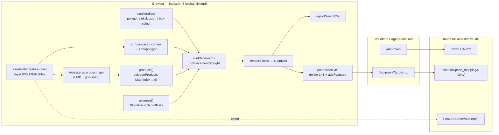

# Discovery 1 — Nuværende tilstand

> Status: discovery (ingen kode, infrastruktur eller ArcGIS-data er ændret)
> Dato: 2026-11-07 · Grundlag: commit `859849b` (2026-03-06), hele repositoryet gennemlæst
> Relaterede dokumenter: [Geometri og kapacitet](DISCOVERY-GEOMETRY-AND-CAPACITY.md) · [Optimering](DISCOVERY-OPTIMIZATION.md) · [UX](DISCOVERY-UX-CONCEPTS.md) · [Arkitektur](DISCOVERY-ARCHITECTURE.md) · [Roadmap](DISCOVERY-ROADMAP.md)

## 1. Resumé

Camping Space Mapper er en velfungerende prototype, der løser én opgave godt: at tegne blokke af rektangulære campingpladser ind i en polygon på et satellitkort, og at skubbe resultatet til ArcGIS. Den er bygget på to dage (5.–6. marts 2026, 26 commits) og bærer præg af det: én fil, global tilstand, ingen tests og ingen persistens.

Vigtigste konklusioner:

1. **Appen er et layoutværktøj, ikke et kapacitetsværktøj.** Det eneste arealtal, den viser, er summen af polygonarealerne (brutto, med dobbelttælling ved overlap). Den har intet begreb om netto- eller disponibelt areal, personer pr. plads, hektar, zoner på tværs af år eller godkendte tal. Forretningsbehovet ("hurtigt kapacitetsoverblik, så snart zonepolygonerne foreligger") er derfor i dag kun dækket indirekte via en fuld optegning.
2. **Placeringskernen er sund, men søgningen omkring den er svag.** De to placeringsalgoritmer laver gyldige layouts inden for én simpel polygon, og eksklusionszoner respekteres korrekt (målt: 0 overtrædelser). Optimeringen afsøger derimod kun 0–85° i 5°-trin og bruger offsets, der er hardkodet til standardproduktet. Målt på syntetiske zoner taber det **op til 10 % (greedy) og 27 % (straight paths)** kapacitet i forhold til en bedre søgning med de *samme* algoritmer.
3. **Geometrihåndteringen har reelle fejl:** huller ignoreres (målt: 90 af 799 pladser placeret i et hul), MultiPolygon-input fra concave hull giver en **uendelig løkke**, der fryser fanen, og overlappende zoner giver dobbeltplacering (målt: 418 overlappende pladspar) og dobbelttalt areal (+14 %).
4. **"Push to ArcGIS" er en højrisikofunktion:** ét klik sletter *alle* features i mållaget (`where=1=1`, `rollbackOnFailure=false`) uden bekræftelse, backup eller verifikation af, om de nye features faktisk blev skrevet.
5. **Proxy-funktionen `/arc-proxy` er en åben relay** til ethvert endpoint på `maps.roskilde-festival.dk` fra ethvert origin.

## 2. Inventar

| Fil | Linjer | Indhold |
|---|---:|---|
| `index.html` | 2.162 | Hele appen: CSS (≈350 linjer), HTML-panel (≈260), JavaScript (≈1.540) |
| `functions/arc-token.js` | 31 | Cloudflare Pages Function: proxy til OAuth-tokenendpoint |
| `functions/arc-proxy.js` | 54 | Cloudflare Pages Function: generel POST-proxy til ArcGIS REST |
| `README.md` | 78 | Funktioner, opsætning, brug |

Afhængigheder, alle fra CDN uden byggetrin, versionslås eller Subresource Integrity ([index.html:621-624](index.html#L621)):

| Bibliotek | Version | Bemærkning |
|---|---|---|
| Leaflet | 1.9.4 | Stabil, men 1.x er i vedligeholdelsestilstand (2.0 er på vej) |
| Leaflet.draw | 1.0.4 | **Uvedligeholdt** siden 2018 |
| Turf.js | 6.5.0 | Turf 7 (2024) har robuste boolske operationer (polyclip-ts) |
| esri-leaflet | `@3` | **Flydende major-version**: hver ny 3.x-udgivelse indlæses automatisk |

Der findes ikke `package.json`, `.gitignore`, tests, lint, typecheck eller CI. Mappen `.wrangler/` (lokal Wrangler-state) er utracked og ikke ignoreret.

## 3. Arkitektur og dataflow

**Tilstandsmodel.** Alt ligger i globale variable i ét `<script>`: `drawnPolygons[]`, `drawnExclusions[]`, `products[]`, og tre `Map`s nøglet på *array-indeks* (`polygonProducts`, `polyLayers`, `polyResults`). Resultatet lever kun som Leaflet-lag med påhæftede private felter (`_polyIndex`, `_blockKey`, `_circleExport`). Der er ingen domænemodel adskilt fra visningen. Eksport og push læser geometrien tilbage *fra kortlagene*.

**Persistens.** Ingen. En genindlæsning sletter zoner, produkter, eksklusioner og layout. Kun ArcGIS-tokenet gemmes (i `sessionStorage`).

## 4. ArcGIS-autentificering og lagintegration

- **OAuth 2.0 Authorization Code + PKCE** ([index.html:1363-1413](index.html#L1363)) er korrekt implementeret: S256-challenge, tilfældig `state`, som verificeres, og ingen client secret. Client-ID'et i kildekoden er offentligt i en PKCE-model og ikke en hemmelighed.
- Tokenudvekslingen går via `/arc-token`, fordi portalens tokenendpoint ikke svarede med CORS-headere. Det er værd at undersøge, om portalens `allowedOrigins` kan konfigureres, så proxyen kan fjernes helt (se [Arkitektur §6](DISCOVERY-ARCHITECTURE.md)).
- Tokenet gemmes i `sessionStorage`. Der er ingen refresh-token-håndtering, og udløb tjekkes kun ved sideindlæsning, ikke før push ([index.html:2039](index.html#L2039)).
- **Læselag:** `AllEditables_GODKENDT_V3_PRO/FeatureServer/835` hentes med `L.esri.featureLayer` uden `where`- eller `fields`-filter. esri-leaflet henter features pr. kortudsnit, så box- og polygon-select ([index.html:1439-1464](index.html#L1439)) kan kun vælge features, der *allerede er indlæst* i det aktuelle udsnit. Features uden for udsnittet udelades lydløst.
- **Skrivelag:** én hardkodet mulighed, `Hosted/Space_mapping/FeatureServer/0` ("Camping West") ([index.html:528](index.html#L528)).

## 5. Areal- og kapacitetsberegninger

| Tal i UI | Beregning | Vurdering |
|---|---|---|
| "Area (m²)" | `Σ turf.area(polygon)` over alle tegnede zoner ([index.html:717-720](index.html#L717)) | Brutto. Overlap tælles dobbelt. Eksklusioner fratrækkes ikke. Sfærisk areal (−0,24 % i forhold til ellipsoiden, målt) |
| "Total spaces" | `Σ ncols × nrows` over placerede blokke | Bedste *fundne* layout ved de valgte parametre, ikke en kapacitet |
| "Groups placed" | Antal blokke | — |
| "Best rotation" | Vinklen fra seneste kørsel | Én vinkel for alle zoner |
| "OPTIMAL"-badge | Vises efter `optimize()` | **Misvisende**: det er det bedste af 162 forsøg, ikke et dokumenteret optimum |
| Areal pr. zone / eksklusion | `turf.area` i sidepanelet | Brutto |

Der findes ikke: hektar, nettoareal, disponibelt eller optegningsegnet areal, personkapacitet, kapacitet pr. produkt, sammenligning mellem år, beregningsversion, forudsætningsliste eller skelnen mellem beregnet og godkendt.

## 6. Placeringsalgoritmerne

Begge algoritmer arbejder i et lokalt metrisk koordinatsystem omkring zonens centroid, med en ækvirektangulær tilnærmelse (111.320 m pr. grad; [index.html:804-817](index.html#L804)). Begge bruger en *blok* som enhed: `ncols × nrows` pladser af `spaceW × spaceH` med `spaceGap` imellem og `pathW` sti rundt om. En blok accepteres, hvis alle fire hjørner ligger i zonens **ydre ring**, ingen blokkant krydser en zonekant, og blokken ikke overlapper en eksklusionszone ([index.html:872-906](index.html#L872)).

### 6.1 Greedy row-by-row (`runPlacement`, [index.html:913-980](index.html#L913))

Algoritmen fejer rækker hen over zonens roterede bounding-diagonal. I hver position prøver den først den største blok (`maxRows` → 1, `maxCols` → 1) og tager den første, der passer. Rækkeafstanden er rækkens højeste blok plus `pathW`. Der er ingen tilbagesporing.

- *Styrker:* simpel, deterministisk og hurtig (≈6 ms for en zone på 25 ha i V8, målt). Den udnytter uregelmæssige kanter godt, fordi blokbredden varierer frit.
- *Svagheder:* 1-rækkes blokke i en 2-rækkes række efterlader en ubrugt strimmel. Stier mellem blokke flugter ikke fra række til række. Resultatet afhænger stærkt af startoffset og vinkel.

### 6.2 Straight walking paths (`runPlacementStraight`, [index.html:990-1095](index.html#L990))

Den kører i to faser:

1. Kolonnebredder bestemmes adaptivt, så stierne mellem kolonnerne bliver lige korridorer.
2. Hver kolonne fejes i Y-retningen.

- *Styrke:* driftsmæssigt pænere layout med gennemgående stier.
- *Fejl:* fase 1 ignorerer eksklusionszoner ([index.html:1041](index.html#L1041), [1045](index.html#L1045)). Kolonnebredden vælges, som om en vej på tværs ikke fandtes, og fase 2 må så skære blokkene ned.

### 6.3 Optimering (`optimize`, [index.html:1935-1999](index.html#L1935))

Den afprøver 18 vinkler (0, 5, …, 85°) × X-offsets `[0, 17, 34]` × Y-offsets `[0, 8, 16]` = 162 kørsler. Den maksimerer *summen* over alle valgte zoner med **én fælles vinkel og offset**.

Problemer (målt i [Optimering](DISCOVERY-OPTIMIZATION.md)):

- Blokke er ikke kvadratiske, så θ og θ+90° er forskellige layouts. Intervallet 90–180° afsøges aldrig.
- Offsets er hardkodet til produktet 5×10 m / 10×2. For andre produkter afsøges perioden skævt.
- 5°-trin rammer ikke zoner, der er tegnet efter UTM-gitteret: de ligger 2,54° fra geografisk nord ved Dyrskuepladsen.
- Commit `859849b` reducerede søgningen fra 2.250 til 162 kørsler med påstanden "negligible quality loss". Målingen viser op til −13 % for straight paths på enkle former.
- Fælles vinkel for alle zoner: målt **−8 %** på tre forskelligt orienterede zoner i forhold til optimering pr. zone.

### 6.4 "Analyse as product type" ([index.html:1535-1706](index.html#L1535))

Funktionen afleder produktparametre fra eksisterende ArcGIS-features: minimum oriented bounding box pr. feature, median-dimensioner, grid-snapping, BFS-komponenter som blokke, og huller i kolonne/række-histogrammet som stibredde. Den er værdifuld, fordi den kan kalibrere modellen mod historiske, faktisk optegnede felter. Den bør bevares og styrkes. Heuristikkerne er dog skrøbelige:

- Grid-snapping forudsætter, at `spaceGap` er cirka 0.
- Stibredden udledes af globale kolonnehuller på tværs af hele udvalget, og forskudte blokke udvisker dem.
- Funktionen `round5` runder til 0,5 m, ikke 5.
- L-formede komponenter overvurderer `maxCols` og `maxRows`.

## 7. Geometrihåndtering

| Forhold | Nuværende adfærd | Konsekvens |
|---|---|---|
| Huller (indre ringe) | Kun `coordinates[0]` bruges i placering og eksklusion ([index.html:923](index.html#L923), [927](index.html#L927), [1002](index.html#L1002), [1006](index.html#L1006)) | Pladser placeres i huller (målt 90/799). UI-arealet *fratrækker* hullet, så tallene er indbyrdes inkonsistente |
| MultiPolygon | `coordinates[0]` er en ring-liste, ikke en ring, så tom koordinatliste og `diag = Infinity` | **Uendelig løkke, fanen fryser.** Opstår når `turf.concave` returnerer MultiPolygon (to adskilte feature-klynger, målt) |
| Overlap mellem zoner | Hver zone placeres uafhængigt | Dobbeltplacering (målt 418 overlappende pladspar ved 50 m overlap) og dobbelttalt areal (+14,3 %) |
| Validitet | Leaflet.draw forbyder selvskæring ved tegning. Hull- og ArcGIS-geometri valideres ikke | Ugyldig input giver udefineret adfærd |
| Projektion | Lokal ækvirektangulær, kugle med 111.320 m/grad | Pladser bliver 0,23 % for brede øst–vest (målt 5,0115 m for 5 m). Nord = geografisk nord, ikke UTM-gitternord (2,54° forskel) |
| Areal | `turf.area` (kugle, R = 6.371.008,8 m) | −0,24 % i forhold til WGS84-ellipsoiden (målt) |
| Cirkler | Placeres i kvadratisk gitter, eksporteres som 32-kant | Ingen hex-pakning. 32-kanten har 0,6 % mindre areal end cirklen |
| Zone-identitet | Array-indeks | Sletning af én zone nulstiller *alle* produkttildelinger ([index.html:792](index.html#L792)) |

## 8. Eksport og publicering

- **GeoJSON-eksport** ([index.html:2008-2034](index.html#L2008)): én feature pr. plads med `product_type`, `area_index` og `block_key`. Der er ingen metadata om år, scenarie, beregningsversion, parametre eller kildezone-ID. `area_index` er et indeks, der skifter ved sletning.
- **Push to ArcGIS** ([index.html:2036-2108](index.html#L2036)):
  1. Funktionen kalder `deleteFeatures` med `where=1=1` og `rollbackOnFailure=false` — alt slettes.
  2. Derefter kalder den `addFeatures` i bidder på 500.
  3. Den tjekker kun den overordnede `error`-nøgle. Svarene `deleteResults[]`/`addResults[]` pr. feature med `success:false` ignoreres, så **delvis fejl rapporteres som succes**.
  4. Fejler en bid halvvejs, står laget tomt eller halvt skrevet uden backup.
  5. Der er ingen `confirm()`; kun en advarselstekst.
  6. Alle svar logges til konsollen.

## 9. Performance (målt i Node 25 / V8, samme JS-motor som Chrome)

| Måling | Resultat |
|---|---|
| Én greedy-kørsel, zone på 6 ha (300×200 m) | ≈2–7 ms |
| Én greedy-kørsel, zone på 25 ha (500×500 m) | ≈6 ms, 3.349 pladser |
| Nuværende `optimize()`, én zone på 25 ha (162 kørsler) | ≈0,67 s |
| Udvidet søgning 0–180° (2.700 kørsler), uregelmæssig zone på 8 ha | 5–11 s |

Alt kører på main-thread i en `setTimeout(…, 30)`. Ved 20–30 zoner vil den nuværende optimering fryse UI i 10–20 s, og en bedre søgning gør det værre. Det taler for Web Workers (se [Arkitektur](DISCOVERY-ARCHITECTURE.md)). Rendering via `L.canvas` er en god beslutning, men hver plads er stadig et Leaflet-objekt med egne event-handlere.

## 10. Testbarhed

- Placeringsfunktionerne er *næsten* rene. De læser globalt `drawnExclusions` og kalder `polygon.toGeoJSON()`. De kunne udtrækkes til Node uden ændringer (gjort i denne discovery, se [Optimering §6](DISCOVERY-OPTIMIZATION.md)).
- UI, tilstand og ArcGIS-kald er sammenflettet og kan ikke testes uden en browser.
- Der er ingen fixtures, ingen golden files og ingen benchmark.

## 11. Sikkerhed

| ID | Fund | Alvor | Sted |
|---|---|---|---|
| S1 | Destruktiv "replace"-push uden bekræftelse, backup, transaktion eller verifikation | **Kritisk** | [index.html:2036-2108](index.html#L2036) |
| S2 | `/arc-proxy` videresender POST til *enhver* sti på ArcGIS-værten (portal-admin, `generateToken` m.fl.). CORS `*`, ingen autentificering, ingen metode- eller stiallowlist. Protokol og port er ikke låst (kun hostname tjekkes) | **Høj** | [functions/arc-proxy.js:32](functions/arc-proxy.js#L32) |
| S3 | `/arc-token` videresender vilkårlig body (vilkårligt client_id og grant type) til tokenendpointet. Offentligt tilgængelig | Middel | [functions/arc-token.js:14-24](functions/arc-token.js#L14) |
| S4 | CDN-scripts uden SRI, flydende `esri-leaflet@3`, ingen CSP — på en side, der har et skrivetoken i hukommelsen | Middel–høj | [index.html:621-624](index.html#L621) |
| S5 | Token i `sessionStorage` (læsbart ved XSS), intet udløbstjek før skrivning, ingen refresh | Middel | [index.html:1403](index.html#L1403) |
| S6 | `innerHTML` med brugerindtastede produktnavne (self-XSS) | Lav | [index.html:1754-1773](index.html#L1754) |
| S7 | Alle ArcGIS-svar logges i konsollen | Lav | [index.html:2050](index.html#L2050) |
| S8 | Selve appen har ingen adgangskontrol (kun ArcGIS-data er beskyttet). Proxyerne er offentlige | Middel (pga. S2) | — |

Forslag til sikker publicering står i [Arkitektur §7](DISCOVERY-ARCHITECTURE.md).

## 12. Fejlkatalog og teknisk gæld

Alvor: **K** = kritisk, **H** = høj, **M** = middel, **L** = lav. Evidens: *målt* = reproduceret i benchmarkharness, *kode* = udledt af kildekoden.

| ID | Alvor | Fund | Evidens |
|---|---|---|---|
| F01 | K | Push sletter hele mållaget uden bekræftelse/backup; delvise fejl rapporteres som succes (S1) | kode |
| F02 | K | MultiPolygon-zone (fra concave hull) giver uendelig løkke i begge placeringsalgoritmer | målt |
| F03 | H | Huller ignoreres i placering og eksklusioner | målt (90/799 pladser i hul) |
| F04 | H | Overlappende zoner giver dobbeltplacering og dobbelttalt areal | målt (418 par, +14,3 % areal) |
| F05 | H | Optimering afsøger kun 0–85° i 5°-trin med hardkodede offsets | målt (op til −10 % greedy / −27 % straight) |
| F06 | H | Én fælles vinkel for alle zoner | målt (−8 % på 3 zoner) |
| F07 | H | Åben proxy (S2) | kode |
| F08 | M | "OPTIMAL"-badge påstår et optimum, der ikke er dokumenteret | kode |
| F09 | M | Straight-paths fase 1 ignorerer eksklusioner | kode |
| F10 | M | Areal-KPI er brutto og dobbelttæller. Ingen netto, ha, personer, år eller status | kode |
| F11 | M | Ingen persistens, import/eksport af projekt eller undo | kode |
| F12 | M | Zone-identitet er array-indeks; sletning nulstiller produkttildelinger | kode |
| F13 | M | Box/poly-select på ArcGIS-features ser kun features i det indlæste udsnit | kode |
| F14 | M | Concave hull-areal afhænger stærkt af "max edge" (3.217 vs 20.373 m² for samme 320 features) | målt |
| F15 | M | Supply chain: ingen SRI, flydende version, ingen CSP (S4) | kode |
| F16 | M | Al beregning på main-thread | målt |
| F17 | L | Projektionstilnærmelse: +0,23 % øst–vest, −0,24 % areal; nord ≠ UTM-gitternord | målt |
| F18 | L | Analyse-heuristikker skrøbelige ved gap > 0, forskudte blokke og L-former | kode |
| F19 | L | UI-labels "0–54" og "0–24" og offset-trin er hardkodet til standardproduktet | kode |
| F20 | L | README beskriver den gamle optimering (90×5×5) | kode |
| F21 | L | Eksporterede features mangler år/scenarie/version/kilde-ID | kode |
| F22 | L | Eksklusioner kan ikke redigeres eller importeres fra ArcGIS og har ingen buffer | kode |
| F23 | L | `.wrangler/` utracked uden `.gitignore` | kode |
| F24 | L | Ingen tests, lint, typecheck eller CI | kode |

**Hvad fungerer og bør bevares:** PKCE-login, eksklusionslogikken (0 overtrædelser målt), blokmodellen som begreb, canvas-rendering, "Analyse as product type" som kalibreringsidé, GeoJSON-eksport som sikker standardvej, og den lave opstartsfriktion (ingen installation).
