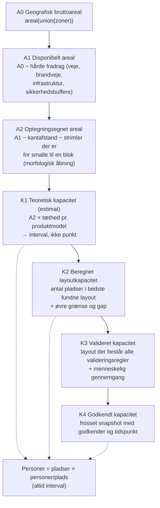
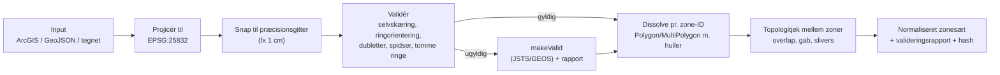

# Discovery 2 — Geometri og kapacitet

> Status: discovery · Dato: 2026-11-07
> Princip: **Ingen udokumenterede kapacitetsantagelser.** Hver parameter i dette dokument er enten (a) målt, (b) hentet fra en navngiven kilde, eller (c) markeret som *ukendt — skal fastlægges*.

## 1. Problemet i én sætning

Appen kender i dag kun to tal: summen af tegnede polygonarealer og antallet af placerede pladser i det bedste fundne layout. Forretningen har brug for en **kæde af veldefinerede tal** fra rå zonegeometri til godkendt kapacitet, hvor hvert led har en eksplicit definition, kilde og status. Kun sådan kan tallene sammenlignes på tværs af år og scenarier uden dobbelttælling.

## 2. Kapacitetstrappen — foreslåede definitioner



| Niveau | Definition | Enhed | Beregnes | Status-badge |
|---|---|---|---|---|
| **A0** Bruttoareal | Areal af *unionen* af alle zonepolygoner (huller fratrukket) | m², ha | Automatisk ved import | Beregnet |
| **A1** Disponibelt | A0 minus unionen af hårde fradragsgeometrier inkl. typebestemte buffere | m², ha | Automatisk, når fradragslag findes | Beregnet + liste over manglende fradragslag |
| **A2** Optegningsegnet | A1 minus kantafstand, minus de dele, hvor den mindste blok ikke kan ligge (erosion med halv minimum-blokbredde, derefter dilation) | m², ha | Automatisk pr. produkt | Beregnet |
| **K1** Teoretisk | A2 × tæthed. Tætheden er enten (i) analytisk gittertæthed for produktets blokmodel, eller (ii) kalibreret fra historiske layouts | pladser (interval) | Automatisk | **Estimat** |
| **K2** Layout | Antal pladser i bedste fundne layout + øvre grænse + gap | pladser | Optimering | Beregnet (bedste fundne) |
| **K3** Valideret | K2-layout, der består alle valideringsregler (§7), og som er gennemgået | pladser | Validator + menneske | Valideret |
| **K4** Godkendt | K3 frosset i et snapshot med godkender, tidspunkt og beregningsversion | pladser + personer | Eksplicit handling | **Godkendt** |

Konsekvenser for UI og datamodel:

- **Tal fra forskellige niveauer må aldrig lægges sammen.** Et overblik over hele sitet viser for hver zone det højeste *tilgængelige* niveau med tydelig status. Totalen deles op pr. status ("12.400 godkendt + ≈3.100 estimeret"), ikke som ét sammenblandet tal.
- **Personer er altid et interval.** Kilden (repo `rf-camping-command-center`, `20_camping/produkter/get_a_place/README.md`) definerer Get A Place som "50 m² reserveret areal til 6–10 personer". 660 pladser giver altså 3.960–6.600 personer, ikke ét tal.
- **K1 kræver ingen optegning.** Det er nøglen til forretningsmålet: et kapacitetsoverblik minutter efter, at zonerne foreligger.

## 3. Tæthedsmodeller (grundlaget for K1)

### 3.1 Optegnede produkter (blokmodel)

For en uendelig flade med blokke af `c × r` pladser (`w × h` m, mellemrum `g`) og stier af bredden `p` i begge retninger er den analytiske gittertæthed:

```
areal pr. plads = (c·(w+g) − g + p) · (r·(h+g) − g + p) / (c · r)
```

Get A Place med appens standardparametre (5×10 m, 10×2, sti 5 m, gap 0) giver `(50+5)·(20+5)/20 = 68,75 m² pr. plads`. Den rene pladsandel er 50/68,75 = 72,7 %.

Målt mod appens egen algoritme ([Optimering §4](DISCOVERY-OPTIMIZATION.md)) med god søgning når layoutet **99,0–99,8 %** af gittertætheden på regulære zoner (rektangel, L-form, strimmel) og **92,5–93,4 %** på uregelmæssige zoner. Det er et stærkt argument for, at K1 kan estimeres pålideligt for regulære zoner. For uregelmæssige zoner skal der bruges en formfaktor, der kalibreres. Det er hypotese **H3** i [Roadmap](DISCOVERY-ROADMAP.md).

> [!IMPORTANT]
> Gittertætheden er en *reference*, ikke en matematisk øvre grænse. På en endelig zone behøver randblokke ikke sti på ydersiden, så et layout kan i princippet overstige den lidt (målt: strimmel 360 pladser mod reference 360,7). En egentlig øvre grænse kræver LP-relaksering (se [Optimering §5](DISCOVERY-OPTIMIZATION.md)).

### 3.2 Fri camping (tæthedsnorm)

Hovedparten af campingarealet på Roskilde Festival er formentlig *ikke* optegnede felter, men fri camping. Her er kapaciteten `areal × personer pr. m²` efter en norm. **Denne norm findes ikke i appen, og den er ikke fundet i de gennemgåede kilder.** Den skal fastlægges fra RF's egne sikkerheds- eller byplansdokumenter og opbevares som en versioneret parameter med kildehenvisning. Kapacitetsværktøjet skal kunne begge modeltyper; ellers dækker det kun en del af campingen.

### 3.3 Parameterregister (forudsætninger)

Hver produktmodel får en registreret parameterpost:

| Felt | Eksempel (Get A Place) | Kilde |
|---|---|---|
| Pladsdimension | 5 × 10 m | App-standard. 50 m² bekræftet i produktdokumentation; *orienteringen 5×10 er ikke bekræftet* |
| Blok (maks. kolonner × rækker) | 10 × 2 | App-standard — **ukendt om det er RF-praksis** |
| Stibredde | 5 m | App-standard — **ukendt, skal bekræftes af sikkerhed/byplan** |
| Pladsmellemrum | 0 m | App-standard |
| Personer pr. plads | 6–10 | Produktdokumentation |
| Kantafstand til zonegrænse | — | **Ukendt** |
| Gyldig fra / til | RF26 | — |

`40_registry/products.yml` i rf-camping-command-center har `capacity: null` for de fleste produkter og ingen dimensioner. Parameterregistret er derfor en reel datamangel, ikke kun en softwareopgave.

## 4. Præcis polygonunion i stedet for hull-estimater

Appen danner i dag zoner fra ArcGIS-features med `turf.concave` over alle hjørnepunkter. Det er en *heuristisk omhyllingskurve*, ikke et areal med en fast definition. Målt på 320 features på hver 5×10 m i 16 blokke med 5 m stier (eksakt featureareal 16.000 m²):

| Metode | Areal | Afvigelse fra featuresum |
|---|---:|---:|
| Sum af featurearealer | 15.959 m² (turf) | −0,3 % (sfærisk fejl) |
| Concave hull, max edge 25/50/100 m | 20.373 m² | +27,7 % (inkluderer indre stier) |
| Concave hull, max edge 10 m | 3.217 m² | **−79,9 %** (kollapser til fragmenter) |

Hullet afhænger altså af en UI-parameter. Under en vis tærskel giver det nonsens, og ved adskilte klynger returnerer det MultiPolygon, som får placeringen til at hænge (fejl F02).

**Anbefaling.** Skeln mellem to forskellige spørgsmål:

1. *"Hvor stort er zonen?"* Zonens areal skal komme fra en **autoritativ zonepolygon** (det lag, byplan og GIS leverer), ikke fra en hull af underliggende features. Arealet er `area(union(zone))` beregnet i EPSG:25832.
2. *"Hvor meget areal dækker de eksisterende felter?"* Det er `area(union(features))` og bruges til kalibrering og år-til-år-sammenligning af faktisk optegning.

En omhyllingskurve kan bevares som tegneværktøj ("foreslå zone ud fra valgte features"), men resultatet skal valideres og eksplicit accepteres som zone, og metoden skal fremgå af zonens metadata.

## 5. Huller, multipolygoner, overlap og naboskab

### 5.1 Normaliseringspipeline (al input)



- **MultiPolygon er en førsteklasses type.** Placering kører pr. polygondel, og arealer summeres over dele.
- **Huller respekteres overalt:** i areal (det gør turf allerede), i blokaccept (en blok må ikke skære en indre ring) og i eksklusioner.
- **Valideringsrapporten er et produkt i sig selv.** "Zone C har 2 selvskæringer, rettet automatisk, arealændring 0,4 m²" vises i UI og gemmes i snapshot.

### 5.2 Overlappende og tilstødende zoner — undgå dobbelttælling

Målt på to zoner på 200×200 m med 50 m overlap:

- Rapporteret areal 79.797 m², men unionen er 69.822 m² (+14,3 %).
- Rapporteret kapacitet 1.078 pladser, hvoraf 418 pladspar fysisk overlapper.

Forslag:

1. **Sitetotal = areal(union(alle zoner)).** Den er aldrig en sum af zonearealer.
2. **Zonetotaler skal summere til sitetotalen.** Derfor beregnes zonearealer på en *partition*: overlap tildeles efter en eksplicit regel (prioritetsrækkefølge, eller "tildel til zonen med størst andel") og vises som en separat post "overlap: 10.000 m², tildelt zone A".
3. **Topologitjekket markerer** overlap over en tærskel (fx > 1 m²) som fejl og gab under en tærskel mellem tilstødende zoner (fx < 0,5 m bred) som "sliver — sandsynlig digitaliseringsfejl". Tærsklerne er parametre med kilde.
4. **Placering sker på partitionen,** så to zoner aldrig kan placere pladser på samme areal. Validatoren (§7) tjekker desuden parvist overlap mellem *alle* pladser på tværs af zoner som sidste værn.

## 6. Eksklusioner, buffere og friholdte arealer

Eksklusionslogikken i dag er korrekt for simple polygoner (målt: 0 pladser i en 12 m vej, begge algoritmer). Der mangler til gengæld:

| Behov | Forslag |
|---|---|
| Typer | Eksklusioner får en type: vej, brandvej, redningsvej, infrastruktur (toilet/vand/strøm), træ/beplantning, hegn, scene/lydzone, fri |
| Buffere | Buffer pr. type i meter, beregnet i EPSG:25832. **Værdierne er ukendte og skal komme fra RF's sikkerheds- og beredskabskrav** |
| Import | Eksklusioner kan hentes fra ArcGIS-lag (veje, infrastruktur) i stedet for kun at blive tegnet manuelt |
| Linjer og punkter | Veje som linjer med bredde, master og træer som punkter med radius. Bufferen gør dem til polygoner |
| Hårde vs. bløde | Hårde fradrag påvirker A1. Bløde ("foretrukket fri") påvirker kun scoring i optimeringen |
| Gennemsigtighed | A0 → A1 vises som et vandfald pr. fradragstype (se [UX](DISCOVERY-UX-CONCEPTS.md)) |

## 7. Validering af layouts — generator og validator adskilles

Ethvert layout, uanset om det kommer fra en algoritme, manuel redigering eller import fra ArcGIS, valideres af **én uafhængig validator** med eksplicitte regler. Algoritmen må aldrig selv erklære sit resultat gyldigt.

| Regel | Tjek | Tolerance |
|---|---|---|
| V1 Inden for zone | Hver plads ⊂ zone (inkl. huller) | ≤ 1 cm² udenfor |
| V2 Ikke i eksklusion | Hver plads ∩ (eksklusion ⊕ buffer) = ∅ | 0 |
| V3 Intet overlap | Parvist, inden for og på tværs af zoner (R-tree) | ≤ 1 cm² |
| V4 Stibredde | Mindsteafstand mellem blokke ≥ `pathW` | ≥ −1 cm |
| V5 Blokgrænser | `ncols ≤ maxCols`, `nrows ≤ maxRows` | 0 |
| V6 Dimensioner | Plads = produktdimension i EPSG:25832 | ±1 cm |
| V7 Kantafstand | Afstand til zonegrænse ≥ parameter | Parameter |
| V8 Tilgængelighed *(senere)* | Hver blok grænser op til et sammenhængende stinet, der når en indgang eller vej | — |

Validatoren producerer en maskinlæsbar rapport, der indgår i snapshot og eksport. Godkendelse blokeres ved mindst én overtrædelse af V1–V6 (se [Arkitektur §7](DISCOVERY-ARCHITECTURE.md)).

## 8. Projektion og målenøjagtighed

Målt ved Dyrskuepladsen (55,627° N, 12,076° Ø) mod geodætisk sandhed (WGS84, GeographicLib):

| Størrelse | App i dag | Sandhed | Afvigelse |
|---|---:|---:|---:|
| Placeret pladsbredde øst–vest (tilsigtet 5 m) | 5,0115 m | 5,000 m | +0,23 % |
| Placeret pladsdybde nord–syd (tilsigtet 10 m) | 10,0013 m | 10,000 m | +0,01 % |
| Areal af 300×200 m-zone (`turf.area`) | 59.847,5 m² | 59.992,8 m² (ellipsoide) | −0,24 % |
| Areal i UTM 32N (EPSG:25832) | — | 60.000 m² | +0,01 % (skalafaktor ≈ 1,00006) |
| UTM 32N-gitternord i forhold til geografisk nord | 0° | 2,54° | — |

Vurdering:

- Afvigelserne er små og systematiske. Konsekvensen er, at pladser i virkeligheden er 0,24 % større end planlagt, og at arealer underestimeres med 0,24 %.
- For formelle kapacitetstal skal *metoden* være fast og dokumenteret: hvilket CRS og hvilken arealformel. Ellers kan tal fra appen og ArcGIS ikke afstemmes.
- **Gitternord er det vigtige fund.** Zoner, der er tegnet langs UTM-gitteret, ligger 2,54° skævt i appens referenceramme, og 5°-søgningen rammer aldrig den rigtige vinkel. Målt koster det op til 4,6 % på en simpel rektangulær zone.

**Anbefaling:** Al beregning foregår i **EPSG:25832 (ETRS89 / UTM 32N)**, dansk standard og sandsynligvis RF-GIS' eget CRS. Det sidste skal bekræftes ved at læse `spatialReference` på lagene. Proj4js kan konvertere. Arealer rapporteres som planareal i EPSG:25832, med ellipsoideareal som kontroltal. "0° rotation" defineres som gitternord, og zonens kantretninger bruges som kandidatvinkler (se [Optimering](DISCOVERY-OPTIMIZATION.md)).

## 9. Kan planlagte felter overlappe eller overskride grænser?

| Scenarie | I dag | Med forslaget |
|---|---|---|
| Overlap inden for samme zone og kørsel | Nej (algoritmen rykker mindst blok + sti frem) | Nej + V3 som værn |
| Overlap mellem zoner | **Ja** (målt) | Nej: partition + V3 |
| Plads i hul | **Ja** (målt) | Nej: V1 |
| Plads uden for zone | Nej for simple polygoner. Udefineret for MultiPolygon (hænger) | Nej: V1 |
| Plads i eksklusion | Nej (målt) | Nej + buffer (V2) |
| Plads delvis uden for zonen efter reprojektion til ArcGIS | Praktisk nej: under 1 cm ved disse afstande | V1 med tolerance |
| Manuelt flyttet blok | Ikke muligt i dag | Valideres løbende |

## 10. Sammenligning mellem år

- **Stabil zone-ID** er forudsætningen. Zoner matches mellem år på ID og, hvor ID mangler, på geometrisk overlap (IoU ≥ tærskel), med manuel bekræftelse.
- Ændringen dekomponeres, så man kan se *hvorfor* kapaciteten ændrede sig:
  - **Arealeffekt:** ΔA2 × tæthed
  - **Modeleffekt:** Δtæthed × A2, dvs. ændrede produktparametre
  - **Layouteffekt:** K2 − K1, dvs. formfaktor og søgekvalitet
- Hvert år og scenarie peger på et frosset zonesæt-snapshot (hash), så RF26-tallene kan reproduceres, også når zonelaget i ArcGIS senere redigeres.

## 11. Datamangler og ukendte forhold (samlet)

| # | Mangel | Påvirker | Ejer (forslag) |
|---|---|---|---|
| D1 | Autoritativt lag for zonepolygoner. Zonerne leveres i et separat, årligt opdateret ArcGIS-lag; for RF27 findes kun PowerPoint-skitser. Datakontrakt og krav: [Zoneintegration](DISCOVERY-ZONE-INTEGRATION.md) | A0 og alt efterfølgende | Team GIS |
| D2 | Fradragslag: veje, brandveje, infrastruktur | A1 | GIS / byplan |
| D3 | Buffer- og afstandskrav pr. fradragstype | A1, V2, V7 | Sikkerhed / beredskab |
| D4 | Produktparametre (dimensioner, blokstørrelse, sti) for alle optegnede produkter | K1, K2 | Produktansvarlige |
| D5 | Personer pr. plads og tæthedsnorm for fri camping | Personkapacitet | Camping / sikkerhed |
| D6 | Historiske zoner og faktisk optegnede felter RF22–RF26 | Kalibrering (H3), benchmark | Team GIS |
| D7 | Hvem godkender kapacitetstal, og hvad "godkendt" betyder formelt | K4 | Campingledelse |
| D8 | Om lag 835 og `Space_mapping` har nedstrøms forbrugere (appen skriver ikke til dem, A9) | Forståelse af eksisterende data | Team GIS |
