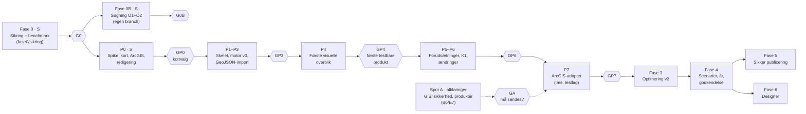

# Discovery 6 — Samlet anbefaling og roadmap

> Status: discovery godkendt med betingelser 2026-11-07 (se [Beslutningslog](DECISION-LOG.md)). Fase 0 udføres på branch `fase0/sikring`; alt andet afventer de porte, der er beskrevet i §5.
> Dato: 2026-11-07 · Bygger på [Nuværende tilstand](DISCOVERY-CURRENT-STATE.md), [Geometri og kapacitet](DISCOVERY-GEOMETRY-AND-CAPACITY.md), [Optimering](DISCOVERY-OPTIMIZATION.md), [UX](DISCOVERY-UX-CONCEPTS.md), [Arkitektur](DISCOVERY-ARCHITECTURE.md) og [Zoneintegration](DISCOVERY-ZONE-INTEGRATION.md)

## 1. Konklusion

Camping Space Mapper er en god prototype på det forkerte abstraktionsniveau for det vigtigste behov. Den kan tegne felter, men den kan ikke give et sporbart kapacitetsoverblik uden optegning. Næste generation bør derfor ikke starte med en flottere designer, men med en **kapacitetsmotor og et overblik**: zoner ind, validerede arealer og estimater ud på minutter, med tydelig status og forudsætninger.

Samtidig viser målingerne, at den eksisterende placeringskerne er bedre end sit ry. Næsten hele den målbare kapacitetsgevinst (op til +27 % pr. zone på syntetiske former) ligger i den **søgning**, der omgiver den. Den kan rettes billigt.

To forhold kræver handling uafhængigt af resten:

- Den destruktive ArcGIS-push.
- Den åbne proxy.

## 2. Bevar · Forbedr · Erstat · Nyt

### Bevar

| Hvad | Hvorfor |
|---|---|
| PKCE-login uden client secret | Korrekt og sikkert flow |
| Blokmodellen (`w×h`, `c×r`, sti, gap) | Rammer domænet. Med god søgning ligger den på 99 %+ af gittertætheden for regulære zoner (målt) |
| Eksklusionslogikken | 0 overtrædelser målt |
| Greedy og straight paths som strategier | Begge er gyldige. Straight paths er næsten gratis med god søgning |
| "Analyse as product type" | Unik kalibreringsmulighed mod faktisk optegning (BR5) |
| GeoJSON-eksport | Sikker standardvej til Team GIS |
| Ingen installation, hurtig opstart | Lav friktion er en kerneværdi |

### Forbedr

| Hvad | Hvordan | Evidens |
|---|---|---|
| Optimeringssøgning | 0–180°, kantafledte vinkler, produktperiode-offsets, lokal forfining | +0–27 % pr. zone (målt) |
| Optimering pr. zone | Uafhængig vinkel/offset pr. zone og polygondel | +8 % på 3 zoner (målt) |
| Geometri | Huller, MultiPolygon, union, partition, EPSG:25832 | F02–F04 (målt) |
| Straight paths fase 1 | Respektér eksklusioner | F09 |
| Analyse-heuristikker | Robust over for gap, forskudte blokke og L-former | F18 |
| Rapportering | "Bedste fundne + grænse + gap" i stedet for "OPTIMAL" | F08 |

### Erstat

| Hvad | Med | Hvorfor |
|---|---|---|
| Push "replace" (delete-all) | Scope-baseret, valideret, godkendt publicering via staging med backup og rollback (P1–P10) | Kritisk risiko (F01) |
| `/arc-proxy` åben relay | CORS-konfiguration (H5) eller smalt allowlist-API bag Cloudflare Access | Høj risiko (F07) |
| Én global tilstand i én fil | `packages/engine` (TS, testet) + SPA med tre arbejdsrum | Testbarhed, skalerbarhed |
| Leaflet.draw (uvedligeholdt) og esri-leaflet | Terra Draw + MapLibre; ArcGIS REST JS | Vedligehold, performance, F13 |
| CDN uden SRI | Bundlede, versionslåste afhængigheder + CSP | F15 |
| Concave hull som zonedefinition | Autoritativt zonelag + union. Hull kun som tegnehjælp | F14 |

### Nye funktioner med størst værdi (rangeret)

1. **Automatisk kapacitetsoverblik ved import** (A0–A2, K1 med interval, status, vandfald, zonetabel). Det dækker direkte forretningsmålet.
2. **Validering og topologirapport** for zonesæt: fanger overlap, gab og ugyldig geometri, før de bliver forkerte tal.
3. **Parameter- og forudsætningsregister** med kilder, koblet til `products.yml`.
4. **År-til-år-sammenligning** med dekomponering (areal, model, layout).
5. **Snapshots og godkendelse** med status Estimeret → Beregnet → Valideret → Godkendt.
6. **Optimering v2 i workers** med grænse og gap.
7. **Sikker publicering** til ArcGIS.
8. **Scenarier** (hvad-hvis) med sammenligningstilstand.

## 3. Ukendte forhold, der skal undersøges

| # | Spørgsmål | Hvorfor det betyder noget | Hvem |
|---|---|---|---|
| U1 | Delvist afklaret: zonerne leveres i et separat ArcGIS-lag, der opdateres hvert år. For RF27 findes kun PowerPoint-skitser; layer-ID og endelig geometri mangler. Åbent: lagets item-ID, skema, ID-konvention og tidsplan. Datakontrakt og krav til GIS er foreslået i [Zoneintegration §3 og §9](DISCOVERY-ZONE-INTEGRATION.md) (se også U11–U14 dér) | Grundlag for A0 og år-sammenligning | Team GIS |
| U2 | Findes fradragslag (veje, brandveje, infrastruktur) i ArcGIS? | A1 uden manuel tegning | Team GIS / byplan |
| U3 | Hvilke afstands- og bufferkrav gælder (brandvej, redningsvej, hegn, scener, træer)? Kilde? | A1, V2, V7. Må ikke gættes | Sikkerhed / beredskab |
| U4 | Dimensioner, blokstørrelse og stibredde for alle optegnede produkter; personer pr. plads; tæthedsnorm for fri camping | K1, K2, personer | Produktansvarlige / camping |
| U5 | Ønsker Team GIS MapLibre + REST eller ArcGIS Maps SDK? Hvilken ArcGIS Enterprise-version (applyEdits, CORS, refresh tokens)? | Arkitekturvalg §2.2 | Team GIS |
| U6 | Hvad er `AllEditables_GODKENDT_V3_PRO/835` og `Space_mapping/0`, og bruger nogen `Space_mapping` nedstrøms? | Risiko ved publicering | Team GIS |
| U7 | Findes historiske zoner og faktisk optegnede felter RF22–RF26? | Benchmark, kalibrering (H1–H3) | Team GIS |
| U8 | Hvem godkender kapacitetstal, og hvornår i årshjulet? | K4, kobling til Camping Portal | Campingledelse |
| U9 | Hvornår foreligger zonepolygonerne typisk, og hvornår skal kapaciteten være godkendt for RF27? | Tidsplan for fase 2 | Campingledelse |
| U10 | Er appen i dag beskyttet af Cloudflare Access eller lignende, og hvem bruger den? | Prioritering af S2/S8 | Ejer |

## 4. Tekniske hypoteser, der skal testes

| # | Hypotese | Test | Succeskriterium |
|---|---|---|---|
| H1 | Forbedret søgning (O1) + pr. zone (O2) giver en median-gevinst ≥ 3 % på historiske zoner, med ≤ 10 s pr. zone i én worker | Benchmark på U7-data, nu mod ny | Median ≥ +3 %, 0 overtrædelser |
| H2 | Strip-DP (O3) er inden for 1 % af ILP-optimum (rækkemodel, fast vinkel) og ≥ greedy på alle fixtures | Offline orakel på delmængde | Gap ≤ 1 %, aldrig dårligere end greedy |
| H3 | K1 (tæthed × A2 × formfaktor) forudsiger K2 inden for ±5 % for optegnede produkter | Kalibrér på RF22–RF25, test på RF26 | Absolut fejl ≤ 5 % for ≥ 90 % af zonerne |
| H4 | MapLibre renderer 30.000 pladser med hover/valg ≥ 50 fps | Prototype med syntetiske data | p95 frame time ≤ 20 ms |
| H5 | Portalens CORS (`allowedOrigins`) kan konfigureres, så begge proxyer kan fjernes | Test mod portal med Team GIS | Token- og REST-kald direkte fra browser |
| H6 | Beregning i EPSG:25832 reproducerer ArcGIS' egne arealer inden for 0,1 % | Sammenlign med `Shape__Area` på zonelaget | ≤ 0,1 % på alle zoner |
| H7 | Topologitjek finder reelle fejl i et historisk zonesæt | Kør på RF26-zoner | Rapporten giver handlingsrettede fund, få falske positive |
| H8 | Flere rotationer pr. zone (O4) giver ≥ 2 % på uregelmæssige zoner efter opdelingstab | Benchmark på uregelmæssige historiske zoner | ≥ 2 % netto. Ellers fravælges O4 |

## 5. Prioriteret implementeringsplan med acceptkriterier

> Opdateret 2026-11-07 efter discovery-review. Beslutninger og betingelser: [Beslutningslog](DECISION-LOG.md). Hver leverance er lille og verificerbar; hver **port** (G…) er et stop/go-punkt, hvor arbejdet stopper, indtil du har godkendt.

Størrelser: **S** = dage, **M** = 1–2 uger, **L** = 3–5 uger (fokuseret udvikling, AI-assisteret). Estimaterne er grove.

### Fase 0 — Sikring af den nuværende app (S) · branch `fase0/sikring` · B1, B5

Den nuværende app forbliver i brug, indtil den nye overtager. Fase 0 ændrer **ikke** placeringsresultaterne for simple polygoner. Det verificeres med en golden-test mod uændret master.

| # | Leverance | Acceptkriterier (verificerbare) |
|---|---|---|
| 0.1 | Repo-hygiejne: `.gitignore`, `package.json` kun med udviklingsafhængigheder, `npm test` og `npm run bench` | Ren klon: `npm ci && npm test` er grøn. Appen får ingen nye runtime-afhængigheder og intet byggetrin |
| 0.2 | Benchmark-harness i `bench/` med syntetiske fixtures; baseline genereret fra **uændret** `master` (`859849b`) | Deterministisk (to kørsler giver identisk JSON). Ingen RF-data i repo |
| 0.3 | Golden-regressionstest | Alle fixtures uden huller, multipolygoner og overlap giver identiske blokke som baseline efter fase 0 |
| 0.4 | Destruktiv push deaktiveret: kodeflag `false`, funktionen afviser, og UI forklarer og henviser til GeoJSON-eksport | Test bekræfter, at push-stien ikke kan nå `deleteFeatures`. Ingen kald til ArcGIS i tests |
| 0.5 | `/arc-proxy` og `/arc-token` begrænset: https, standardport, præcis vært, sti-allowlist, POST, samme origin, `client_id`/`grant_type`-allowlist | Unit tests med mocket `fetch`: alle afvisningstilfælde giver 4xx uden udgående kald; tilladte kald videresendes |
| 0.6 | Kritiske geometrifejl: MultiPolygon (uendelig løkke), huller, overlap mellem zoner, guard mod ikke-endelige værdier; bruttoareal som union | Probe-tests: terminering < 1 s, 0 pladser i huller, målt overlap mellem pladser på tværs af zoner under en tolerance, der testes; arealet viser unionen |
| 0.7 | Supply chain: versionslåste CDN-URL'er med SRI | Statisk test: ingen flydende versioner, `integrity` på alle eksterne scripts og stylesheets. Appen indlæses i browser uden konsolfejl |
| 0.8 | Sandfærdighed og småfejl: "OPTIMAL" → "BEST FOUND", escaping af produktnavne, README ajourført | Statisk test + gennemsyn |
| 0.9 | Lokal browser-røgtest (uden ArcGIS-login og uden skrivning) | Zone indlæses, Calculate, Optimize og eksport virker; MultiPolygon hænger ikke |

**Status 2026-11-07:** Udført lokalt på `fase0/sikring`; alle leverancer 0.1–0.9 opfyldt. Se [Fase 0-rapport](FASE-0-RAPPORT.md).

**Port G0:** Du gennemgår rapport og diff. Tre separate beslutninger: (a) merge til `master`, (b) produktionsdeploy, (c) start af fase 0B.

### Fase 0B — Søgeforbedring O1+O2 (S) · egen branch fra `fase0/sikring` · B2

| # | Leverance | Acceptkriterier |
|---|---|---|
| 0B.1 | Søgning 0–180°, kantafledte vinkler, produktperiode-offsets, lokal forfining | Regressionstest: **aldrig færre** pladser end baseline på nogen fixture × produkt × algoritme |
| 0B.2 | Optimering pr. zone | ≥ fælles vinkel på alle fixtures; gevinst rapporteres |
| 0B.3 | Tidsbudget | Optimize ≤ 3 s pr. discovery-fixture på main-thread, ellers Web Worker |

**Port G0B:** Benchmarkrapporten (gevinst, tid) gennemgås. Merge og deploy er separate beslutninger.

### Kapacitetsprototype (P) — tidligt, testbart visuelt produkt · B3, B4, A1–A6

Erstatter den tidligere fase 1 (motor) og fase 2 (overblik). Indholdet er bevaret, men skåret i små trin, så der hurtigt findes noget at se og teste.

| # | Leverance | Acceptkriterier | Port |
|---|---|---|---|
| P0 | **Teknisk spike** (B4): (a) MapLibre-rendering af 30.000 polygoner med hover/valg (H4); (b) ArcGIS-adapter-prototype, der læser kontrakt-zoner via REST fra et offentligt eksempellag eller en mock (ingen RF-skrivning); (c) redigering med Terra Draw (tegn, flyt hjørner, snapping) | Spike-rapport med målinger og anbefaling: MapLibre eller ArcGIS Maps SDK | **GP0**: endeligt kortvalg |
| P1 | Skelet: `packages/engine` (TS, ingen DOM-, React-, MapLibre- eller ArcGIS-afhængighed) + `apps/capacity` (React + Vite), lint, typecheck, tests | Arkitekturtest fejler, hvis `engine` importerer UI- eller ArcGIS-pakker (A1) | — |
| P2 | Motor v0: normalisering og validering i EPSG:25832; A0 pr. zone og total via union/partition; **snapshot-identitet** (`zoneset_hash`, `geometry_hash`, `engine_version`, `provenance`) fra start (A3); **præcisionsforsøg** (afrunding, tolerancer, reprojektion WGS84↔25832) med dokumenterede resultater, før værdierne låses (A4) | H10 (genimport giver identisk hash); zonetotaler summerer til sitetotal; præcisionsrapport i `bench/` | — |
| P3 | Syntetisk RF-lignende zonesæt + **GeoJSON-import-adapter** efter datakontrakten med kontraktvalidering; proveniens `syntetisk` / `foreloebig` | Gyldige filer importeres; ugyldige giver forklarende fejl; ingen RF-data i repo | **GP3**: motor og import gennemgået |
| P4 | **Første visuelle overblik**: kort med zoner (choropleth efter areal), KPI-række (m², ha, antal zoner pr. proveniens), zonetabel synkroniseret med kortet, drill-down site → zone, statusmærker og FORELØBIG-mærkning, lokale snapshots (IndexedDB + download/upload) | Brugertest med dig: fra GeoJSON-fil til overblik på < 2 min; genindlæst snapshot giver identiske tal | **GP4**: første testbare produkt, go/no-go på retning |
| P5 | Forudsætningsregister (parametre med kilde eller navngiven antagelse), A1/A2/K1-estimat, kapacitetsvandfald | Ingen stille standardværdier; antagelser mærkes og blokerer godkendelse | — |
| P6 | Ændringsdetektion mellem to snapshots + sammenligningsvisning | Klassifikationen er korrekt på testsæt; 0 falske ændringer ved støj under tolerance (H11) | **GP6** |
| P7 | ArcGIS-adapter (kun læsning) med konfigurerbar zonekilde (B9) mod et **testlag** | Et nyt lag tages i brug uden kodeændring (H9). Kræver testlag fra GIS og din godkendelse | **GP7** |

Senere trin i samme spor (fra den tidligere fase 2): valideringsrapport for topologi (H7), personer som interval, eksport (CSV, PNG/PDF-brief).

### Spor A — Afklaringer (parallelt) · B6, B7

| # | Leverance | Port |
|---|---|---|
| A.1 | Spørgsmålsliste og mødeoplæg til Team GIS (U1, U2, U5, U6, U7, U11–U14), sikkerhed/beredskab (U3) og produktansvarlige (U4) | — |
| A.2 | Kort, samarbejdsorienteret kravspecifikation til Team GIS (udkast, baseret på [Zoneintegration §9](DISCOVERY-ZONE-INTEGRATION.md)) | **GA**: sendes kun efter din særskilte godkendelse |

### Fase 3 — Optimering v2 (M)

| Leverance | Acceptkriterier |
|---|---|
| Port af greedy/straight til `packages/engine` | Golden-test: porten giver *identiske* pladsantal som `index.html` på alle `bench/`-fixtures, før forbedringer slås til |
| O1 + O2 i workerpool med fremdrift og annullering (bygger på fase 0B) | H1 bekræftet. UI blokeres aldrig > 100 ms |
| Strip-DP (O3) som ny kerne | H2 bekræftet. Ellers beholdes greedy som standard |
| Rapportering "bedste fundne + grænse + gap" | Intet "optimal" uden bevist gap = 0 inden for en navngiven model |
| Validator kører på alle resultater | 0 overtrædelser på hele benchmarket |

### Fase 4 — Scenarier, år-sammenligning og snapshots (M)

| Leverance | Acceptkriterier |
|---|---|
| Scenarie/år-vælger, duplikering, sammenligningstilstand (swipe/delt/Δ) | BR3 kan gennemføres på < 2 min |
| År-matchning (ID + IoU) og dekomponering (areal/model/layout) | Δ-summen af komponenterne = total Δ |
| Snapshots (zonesæt og beregninger) flyttes fra lokal lagring til R2 + metadata i D1, Cloudflare Access foran appen | Snapshot genberegnet med samme motorversion giver identisk hash og tal |
| Statusflow Estimeret → Beregnet → Valideret → Godkendt | Godkendte tal kan ikke ændres, kun erstattes af et nyt snapshot |
| To adskilte godkendelser (A2): GIS-zonegeometri (`zone_status`, ejes af GIS, læses fra kilden) og kapacitetsberegning (`CapacityApproval`, ejes af campingledelsen, bundet til beregningssnapshot) | En kapacitetsgodkendelse kræver, at alle zoner i snapshottet er `gis` + `godkendt`; en ændret GIS-godkendelse ophæver ikke en tidligere kapacitetsgodkendelse, men markerer den "zonegrundlag ændret" (testet) |

### Fase 5 — Sikker publicering (M)

| Leverance | Acceptkriterier |
|---|---|
| Publiceringsflow pr. [Arkitektur §7](DISCOVERY-ARCHITECTURE.md) | P1–P10 opfyldt og testet mod testlag. Produktionsskrivning kun efter godkendelse fra Team GIS |

### Fase 6 — Designer (L) · kortbibliotek efter GP0

| Leverance | Acceptkriterier |
|---|---|
| Kortbibliotek valgt i GP0 + Terra Draw, semantisk zoom, låste blokke, manuel redigering med løbende validering, alternativer (Pareto) | H4 bekræftet. BR2 kan gennemføres uden at forlade kortet. Den gamle app kan pensioneres (funktionsparitet-tjekliste) |

### Fase 7 — Udvidelser (efter behov)

O4 (flere rotationer pr. zone, kun hvis H8 holder), O5 (LNS), O6 (ILP-orakel i CI), O8 (multikriterie inkl. V8-tilgængelighed), hældningsanalyse fra Danmarks Højdemodel, integration med Camping Portal og `products.yml`.

## 6. Beslutninger

Afgjort 2026-11-07; detaljer, betingelser og arkitekturkrav A1–A8 står i [Beslutningslog](DECISION-LOG.md).

| # | Spørgsmål (discovery) | Anbefaling (discovery) | Beslutning |
|---|---|---|---|
| B1 | Godkend fase 0. Skal push deaktiveres helt eller hærdes? | Deaktivér push nu; hærd proxy; ret geometrifejl | **GO**. Ingen produktionsdeploy uden særskilt godkendelse |
| B2 | Søgefix O1+O2 i den nuværende app? | Ja | **Betinget GO**: separat branch med benchmark og regressionstest; ingen produktionsdeploy |
| B3 | UI-framework | React + TS | **GO**: React + TS med framework-uafhængig motor |
| B4 | MapLibre vs. ArcGIS Maps SDK | MapLibre, med forbehold for U5 | **Betinget GO**: MapLibre foretrukket; teknisk spike (P0) før endeligt valg |
| B5 | Benchmark og fixtures i repo? | Ja | **GO**. Ingen følsomme RF-data i offentligt repo |
| B6 | Hvem bidrager til U1–U14? | Møde med Team GIS først | **GO**: forbered afklaringer (spor A) |
| B7 | Må kravene til Team GIS sendes? | Ja, hurtigt | **GO** til udarbejdelse; **må ikke sendes** uden særskilt godkendelse (port GA) |
| B8 | RF27-skitser → foreløbige zoner | A (GIS digitaliserer), ellers B | **GO**: GIS-digitalisering foretrækkes; manuel optegning bevares; begge er foreløbige |
| B9 | Årligt eller fælles zonelag | Understøt begge | **GO**: understøt begge |
