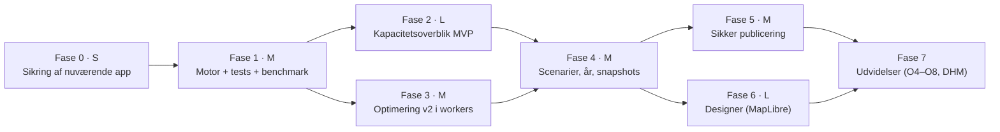

# Discovery 6 — Samlet anbefaling og roadmap

> Status: discovery afsluttet; **afventer godkendelse før implementering**
> Dato: 2026-11-07 · Bygger på [Nuværende tilstand](DISCOVERY-CURRENT-STATE.md), [Geometri og kapacitet](DISCOVERY-GEOMETRY-AND-CAPACITY.md), [Optimering](DISCOVERY-OPTIMIZATION.md), [UX](DISCOVERY-UX-CONCEPTS.md), [Arkitektur](DISCOVERY-ARCHITECTURE.md) og [Zoneintegration](DISCOVERY-ZONE-INTEGRATION.md)

## 1. Konklusion

Camping Space Mapper er en god prototype på det forkerte abstraktionsniveau for det vigtigste behov. Den kan tegne felter, men den kan ikke give et sporbart kapacitetsoverblik uden optegning. Næste generation bør derfor ikke starte med en flottere designer, men med en **kapacitetsmotor og et overblik**: zoner ind, validerede arealer og estimater ud på minutter, med tydelig status og forudsætninger.

Samtidig viser målingerne, at den eksisterende placeringskerne er bedre end sit ry. Næsten hele den målbare kapacitetsgevinst (op til +27 % pr. zone på syntetiske former) ligger i den **søgning**, der omgiver den. Den kan rettes billigt.

To forhold kræver handling uafhængigt af resten:

- Den destruktive ArcGIS-push.
- Den åbne proxy.

## 2. Bevar · Forbedr · Erstat · Nyt

### Bevar

| Hvad | Hvorfor |
|---|---|
| PKCE-login uden client secret | Korrekt og sikkert flow |
| Blokmodellen (`w×h`, `c×r`, sti, gap) | Rammer domænet. Med god søgning ligger den på 99 %+ af gittertætheden for regulære zoner (målt) |
| Eksklusionslogikken | 0 overtrædelser målt |
| Greedy og straight paths som strategier | Begge er gyldige. Straight paths er næsten gratis med god søgning |
| "Analyse as product type" | Unik kalibreringsmulighed mod faktisk optegning (BR5) |
| GeoJSON-eksport | Sikker standardvej til Team GIS |
| Ingen installation, hurtig opstart | Lav friktion er en kerneværdi |

### Forbedr

| Hvad | Hvordan | Evidens |
|---|---|---|
| Optimeringssøgning | 0–180°, kantafledte vinkler, produktperiode-offsets, lokal forfining | +0–27 % pr. zone (målt) |
| Optimering pr. zone | Uafhængig vinkel/offset pr. zone og polygondel | +8 % på 3 zoner (målt) |
| Geometri | Huller, MultiPolygon, union, partition, EPSG:25832 | F02–F04 (målt) |
| Straight paths fase 1 | Respektér eksklusioner | F09 |
| Analyse-heuristikker | Robust over for gap, forskudte blokke og L-former | F18 |
| Rapportering | "Bedste fundne + grænse + gap" i stedet for "OPTIMAL" | F08 |

### Erstat

| Hvad | Med | Hvorfor |
|---|---|---|
| Push "replace" (delete-all) | Scope-baseret, valideret, godkendt publicering via staging med backup og rollback (P1–P10) | Kritisk risiko (F01) |
| `/arc-proxy` åben relay | CORS-konfiguration (H5) eller smalt allowlist-API bag Cloudflare Access | Høj risiko (F07) |
| Én global tilstand i én fil | `packages/engine` (TS, testet) + SPA med tre arbejdsrum | Testbarhed, skalerbarhed |
| Leaflet.draw (uvedligeholdt) og esri-leaflet | Terra Draw + MapLibre; ArcGIS REST JS | Vedligehold, performance, F13 |
| CDN uden SRI | Bundlede, versionslåste afhængigheder + CSP | F15 |
| Concave hull som zonedefinition | Autoritativt zonelag + union. Hull kun som tegnehjælp | F14 |

### Nye funktioner med størst værdi (rangeret)

1. **Automatisk kapacitetsoverblik ved import** (A0–A2, K1 med interval, status, vandfald, zonetabel). Det dækker direkte forretningsmålet.
2. **Validering og topologirapport** for zonesæt: fanger overlap, gab og ugyldig geometri, før de bliver forkerte tal.
3. **Parameter- og forudsætningsregister** med kilder, koblet til `products.yml`.
4. **År-til-år-sammenligning** med dekomponering (areal, model, layout).
5. **Snapshots og godkendelse** med status Estimeret → Beregnet → Valideret → Godkendt.
6. **Optimering v2 i workers** med grænse og gap.
7. **Sikker publicering** til ArcGIS.
8. **Scenarier** (hvad-hvis) med sammenligningstilstand.

## 3. Ukendte forhold, der skal undersøges

| # | Spørgsmål | Hvorfor det betyder noget | Hvem |
|---|---|---|---|
| U1 | Delvist afklaret: zonerne leveres i et separat ArcGIS-lag, der opdateres hvert år. For RF27 findes kun PowerPoint-skitser; layer-ID og endelig geometri mangler. Åbent: lagets item-ID, skema, ID-konvention og tidsplan. Datakontrakt og krav til GIS er foreslået i [Zoneintegration §3 og §9](DISCOVERY-ZONE-INTEGRATION.md) (se også U11–U14 dér) | Grundlag for A0 og år-sammenligning | Team GIS |
| U2 | Findes fradragslag (veje, brandveje, infrastruktur) i ArcGIS? | A1 uden manuel tegning | Team GIS / byplan |
| U3 | Hvilke afstands- og bufferkrav gælder (brandvej, redningsvej, hegn, scener, træer)? Kilde? | A1, V2, V7. Må ikke gættes | Sikkerhed / beredskab |
| U4 | Dimensioner, blokstørrelse og stibredde for alle optegnede produkter; personer pr. plads; tæthedsnorm for fri camping | K1, K2, personer | Produktansvarlige / camping |
| U5 | Ønsker Team GIS MapLibre + REST eller ArcGIS Maps SDK? Hvilken ArcGIS Enterprise-version (applyEdits, CORS, refresh tokens)? | Arkitekturvalg §2.2 | Team GIS |
| U6 | Hvad er `AllEditables_GODKENDT_V3_PRO/835` og `Space_mapping/0`, og bruger nogen `Space_mapping` nedstrøms? | Risiko ved publicering | Team GIS |
| U7 | Findes historiske zoner og faktisk optegnede felter RF22–RF26? | Benchmark, kalibrering (H1–H3) | Team GIS |
| U8 | Hvem godkender kapacitetstal, og hvornår i årshjulet? | K4, kobling til Camping Portal | Campingledelse |
| U9 | Hvornår foreligger zonepolygonerne typisk, og hvornår skal kapaciteten være godkendt for RF27? | Tidsplan for fase 2 | Campingledelse |
| U10 | Er appen i dag beskyttet af Cloudflare Access eller lignende, og hvem bruger den? | Prioritering af S2/S8 | Ejer |

## 4. Tekniske hypoteser, der skal testes

| # | Hypotese | Test | Succeskriterium |
|---|---|---|---|
| H1 | Forbedret søgning (O1) + pr. zone (O2) giver en median-gevinst ≥ 3 % på historiske zoner, med ≤ 10 s pr. zone i én worker | Benchmark på U7-data, nu mod ny | Median ≥ +3 %, 0 overtrædelser |
| H2 | Strip-DP (O3) er inden for 1 % af ILP-optimum (rækkemodel, fast vinkel) og ≥ greedy på alle fixtures | Offline orakel på delmængde | Gap ≤ 1 %, aldrig dårligere end greedy |
| H3 | K1 (tæthed × A2 × formfaktor) forudsiger K2 inden for ±5 % for optegnede produkter | Kalibrér på RF22–RF25, test på RF26 | Absolut fejl ≤ 5 % for ≥ 90 % af zonerne |
| H4 | MapLibre renderer 30.000 pladser med hover/valg ≥ 50 fps | Prototype med syntetiske data | p95 frame time ≤ 20 ms |
| H5 | Portalens CORS (`allowedOrigins`) kan konfigureres, så begge proxyer kan fjernes | Test mod portal med Team GIS | Token- og REST-kald direkte fra browser |
| H6 | Beregning i EPSG:25832 reproducerer ArcGIS' egne arealer inden for 0,1 % | Sammenlign med `Shape__Area` på zonelaget | ≤ 0,1 % på alle zoner |
| H7 | Topologitjek finder reelle fejl i et historisk zonesæt | Kør på RF26-zoner | Rapporten giver handlingsrettede fund, få falske positive |
| H8 | Flere rotationer pr. zone (O4) giver ≥ 2 % på uregelmæssige zoner efter opdelingstab | Benchmark på uregelmæssige historiske zoner | ≥ 2 % netto. Ellers fravælges O4 |

## 5. Prioriteret implementeringsplan med acceptkriterier

Størrelser: **S** = dage, **M** = 1–2 uger, **L** = 3–5 uger (fokuseret udvikling, AI-assisteret). Estimaterne er grove og skal genbesøges efter fase 1.

### Fase 0 — Sikring af den nuværende app (S) · *kræver din godkendelse*

Den nuværende app forbliver i brug, indtil v2 overtager. Den skal derfor være sikker nu.

| Leverance | Acceptkriterier |
|---|---|
| Push deaktiveres bag et flag *eller* omskrives til: `confirm` med lagnavn, `rollbackOnFailure=true`, tjek af `addResults`/`deleteResults` pr. feature, backup-download af eksisterende features før sletning | Kan ikke udløses ved ét klik. Delvis fejl rapporteres som fejl. Testet mod et testlag, aldrig produktion |
| `/arc-proxy` låses til `https`, port 443, eksakte sti-mønstre for `Space_mapping/FeatureServer/0/{addFeatures,deleteFeatures,applyEdits}`; Origin-tjek; CORS kun eget domæne | Kald til andre stier giver 403 (testet). Eksisterende push virker |
| `/arc-token` låses til eget `client_id` og `grant_type=authorization_code` | Andre bodies giver 400 |
| MultiPolygon og huller: placering pr. polygondel; blokke må ikke skære indre ringe; guard mod `diag` = ∞ | Probe-tests fra discovery: 0 pladser i hul, ingen hængning |
| Versionslåste CDN-URL'er med SRI-hashes | Ingen flydende versioner; SRI på alle scripts |
| `.gitignore` (`.wrangler/`) | — |
| *Valgfri, anbefalet:* søgefix O1+O2 og fjernelse af "OPTIMAL" | Benchmark (syntetisk) viser ≥ nuværende på alle former |

### Fase 1 — Fundament: motor, tests og benchmark (M)

| Leverance | Acceptkriterier |
|---|---|
| `packages/engine` i TypeScript: geometry-core (25832, normalisering, validering), capacity (A0–A2, K1), placement (port af greedy/straight), validator V1–V7 | Golden-tests: porten giver *identiske* pladsantal som `index.html` på alle discovery-fixtures, før forbedringer slås til |
| Benchmark (`npm run bench`) med syntetiske fixtures + første historiske zonesæt (U7) | Deterministisk. Rapport i Markdown/JSON. CI fejler ved overtrædelser eller regression > 0,5 % |
| Probe-tests for F02–F04, F09 | Alle grønne |
| Vite + TS + lint + typecheck + CI | Grøn pipeline på hver PR |

### Fase 2 — Kapacitetsoverblik MVP (L) — *forretningsmålet*

| Leverance | Acceptkriterier |
|---|---|
| Konfigurerbar zonekilde ([Zoneintegration §2](DISCOVERY-ZONE-INTEGRATION.md)): item-ID/lag-URL, `where`, feltmapping, statusmapping; import med paging og `outSR=25832`; GeoJSON efter samme kontrakt | Et nyt års lag tages i brug uden kodeændring (H9). Hele zonesættet indlæses uanset kortudsnit |
| Kontraktvalidering ([Zoneintegration §3.5](DISCOVERY-ZONE-INTEGRATION.md)) | Fejl blokerer import; advarsler vises i datakvalitetslisten |
| Immutable zonesæt-snapshots med kanonisk hash, lokalt (IndexedDB + fil) | Genimport af uændret lag giver identisk hash (H10). Beregninger refererer kun til snapshot-hash |
| Proveniens `gis` / `foreloebig`: tegnede og skitsebaserede RF27-zoner med `TMP-`-ID, skravering og FORELØBIG-mærke | Foreløbige zoner kan ikke nå status Valideret/Godkendt og kan ikke publiceres (testet). Totaler opdeles efter proveniens |
| Ændringsdetektion mellem snapshots ([Zoneintegration §7](DISCOVERY-ZONE-INTEGRATION.md)) | Ny/fjernet/uændret/attribut/geometri klassificeres korrekt på testsæt; støj under tolerance giver 0 falske ændringer (H11) |
| A0 straks; A1/A2/K1 kun med kildehenviste forudsætninger eller navngivne antagelser | Ingen stille standardværdier. Antagelser blokerer godkendelse |
| Valideringsrapport (topologi, overlap, gab) | H7 bekræftet på RF26 |
| A0/A1/A2 og K1 pr. zone og site, i m² og ha, personer som interval | Zonetotaler summerer til sitetotal (partition). A0 inden for 0,1 % af ArcGIS (H6) |
| Overblik: kort-choropleth, KPI-række, kapacitetsvandfald, zonetabel, drill-down site → zone | **Fra zonesæt til fuldt overblik på < 5 min** uden optegning. Alle tal har statusmærke og proveniens |
| Forudsætningsskuffe med parameterregister og kilder; manglende parametre vises eksplicit | Intet tal vises uden kildehenvist parameter eller tydeligt "mangler"-mærke |
| Eksport: CSV + PNG/PDF-brief + snapshot-JSON | Genindlæst snapshot giver identiske tal |

### Fase 3 — Optimering v2 (M)

| Leverance | Acceptkriterier |
|---|---|
| O1 + O2 i workerpool med fremdrift og annullering | H1 bekræftet. UI blokeres aldrig > 100 ms |
| Strip-DP (O3) som ny kerne | H2 bekræftet. Ellers beholdes greedy som standard |
| Rapportering "bedste fundne + grænse + gap" | Intet "optimal" uden bevist gap = 0 inden for en navngiven model |
| Validator kører på alle resultater | 0 overtrædelser på hele benchmarket |

### Fase 4 — Scenarier, år-sammenligning og snapshots (M)

| Leverance | Acceptkriterier |
|---|---|
| Scenarie/år-vælger, duplikering, sammenligningstilstand (swipe/delt/Δ) | BR3 kan gennemføres på < 2 min |
| År-matchning (ID + IoU) og dekomponering (areal/model/layout) | Δ-summen af komponenterne = total Δ |
| Snapshots (zonesæt og beregninger) flyttes fra lokal lagring til R2 + metadata i D1, Cloudflare Access foran appen | Snapshot genberegnet med samme motorversion giver identisk hash og tal |
| Statusflow Estimeret → Beregnet → Valideret → Godkendt | Godkendte tal kan ikke ændres, kun erstattes af et nyt snapshot |

### Fase 5 — Sikker publicering (M)

| Leverance | Acceptkriterier |
|---|---|
| Publiceringsflow pr. [Arkitektur §7](DISCOVERY-ARCHITECTURE.md) | P1–P10 opfyldt og testet mod testlag. Produktionsskrivning kun efter godkendelse fra Team GIS |

### Fase 6 — Designer på MapLibre (L)

| Leverance | Acceptkriterier |
|---|---|
| MapLibre + Terra Draw, semantisk zoom, låste blokke, manuel redigering med løbende validering, alternativer (Pareto) | H4 bekræftet. BR2 kan gennemføres uden at forlade kortet. Den gamle app kan pensioneres (funktionsparitet-tjekliste) |

### Fase 7 — Udvidelser (efter behov)

O4 (flere rotationer pr. zone, kun hvis H8 holder), O5 (LNS), O6 (ILP-orakel i CI), O8 (multikriterie inkl. V8-tilgængelighed), hældningsanalyse fra Danmarks Højdemodel, integration med Camping Portal og `products.yml`.

## 6. Beslutninger, der afventer dig

| # | Beslutning | Anbefaling |
|---|---|---|
| B1 | Godkend fase 0 (ændringer i den nuværende app og proxy). Skal push deaktiveres helt eller hærdes? | Deaktivér push nu, og genindfør den først via fase 5. Hærd proxy og ret geometrifejl |
| B2 | Skal søgefixet (O1+O2) laves i den nuværende app allerede i fase 0? | Ja. Lille indsats, målt gevinst, appen bruges indtil v2 |
| B3 | UI-framework | React + TS (Svelte 5 som alternativ) |
| B4 | MapLibre vs. ArcGIS Maps SDK | MapLibre, med forbehold for U5 |
| B5 | Må benchmark-harness og fixtures fra discovery lægges i repoet (`bench/`)? | Ja. De er grundlaget for alle videre beslutninger |
| B6 | Hvem skal bidrage til U1–U14 (Team GIS, sikkerhed, produktansvarlige)? | Kort afklaringsmøde med Team GIS først (U1, U2, U5, U6, U7, U12–U14) |
| B7 | Må kravene i [Zoneintegration §9](DISCOVERY-ZONE-INTEGRATION.md) sendes til Team GIS som udgangspunkt for zonelaget, før det etableres? | Ja, så hurtigt som muligt. Det er billigere at aftale nu end at reparere bagefter |
| B8 | Hvordan bliver RF27-skitserne til foreløbige zoner: GIS digitaliserer som kladder (A), planlægger tegner i appen (B), eller georefereret billedoverlay (C)? | A, hvis GIS har kapacitet. Ellers B. C kun hvis skitserne er målfaste (U11) |
| B9 | Ét zonelag pr. år eller ét fælles lag med `festival_year`? | Lad GIS vælge; konfigurationen understøtter begge |
