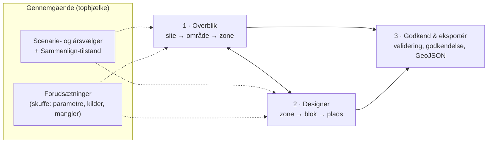

# Discovery 4 — UX-koncepter for næste generation

> Status: discovery · Dato: 2026-11-07

## 1. Udgangspunkt

Den nuværende UX er et 300 px sidepanel med 12 sektioner i én lang kolonne og en vejledning i 7 trin. Den fungerer for én person, der optegner én zone ad gangen. Den understøtter ikke det vigtigste behov: *at se hele årets campingkapacitet på minutter, så snart zonerne foreligger, og forstå hvor tallene kommer fra.*

Designmål i prioriteret rækkefølge:

1. **Tid til første overblik < 5 minutter** fra zonerne foreligger, uden manuel optegning.
2. **Kortet er primært.** Tal står altid i en geografisk kontekst.
3. **Ét klik mellem niveauer:** site → område → zone → blok → plads, og tilbage.
4. **Status er altid synlig:** et estimat kan aldrig forveksles med et godkendt tal.
5. **Sammenligning er en grundfunktion,** ikke et separat modul.
6. **Minimal opstart:** standarder fra parameterregistret, og ingen tom skærm.

## 2. Udfordring af de fire foreslåede moduler

| Foreslået modul | Vurdering |
|---|---|
| **Zone Intelligence** | Rigtigt indhold (areal, fradrag, datakvalitet, estimat), men det er *ikke et separat sted*. Det er indholdet af zoneniveauet i overblikket |
| **Smart Field Designer** | Rigtigt og nødvendigt som separat arbejdsbord. Det er her, der arbejdes detaljeret med én zone |
| **Scenario Lab** | Forkert som modul. Hvis scenarier bor ét sted, bliver de en sideaktivitet. Ethvert tal hører til et scenarie, og sammenligning skal kunne ske i overblik og designer. **Scenarie bør være en global dimension** (vælger i topbjælken) med en *sammenligningstilstand* |
| **Capacity Command Center** | Overlapper med Zone Intelligence: begge er overblik. Navnet antyder live-drift, men værktøjet er til planlægning. Det kolliderer også med det eksisterende repo `rf-camping-command-center` (governance og dokumenter), hvilket vil skabe forvirring. Indholdet (KPI'er, totaler, status) bør være sitniveauet i overblikket |
| **Mangler** | (a) **Godkendelse og publicering** som eget flow: i dag er det én destruktiv knap. (b) **Forudsætninger og data**: produktparametre, fradragsregler, kilder og datamangler. Uden et synligt sted for forudsætninger kan løftet om "ingen udokumenterede antagelser" ikke holdes |

### 2.1 Forslag: tre arbejdsrum og to gennemgående lag

| Arbejdsrum | Spørgsmål det besvarer | Primær bruger |
|---|---|---|
| **1 · Overblik** | Hvor meget kapacitet har vi, hvor, med hvilken sikkerhed, og hvad har ændret sig? | Campingledelse, planlæggere |
| **2 · Designer** | Hvordan ser det bedste layout ud i denne zone, og hvad koster en ændring? | Planlægger, Team GIS |
| **3 · Godkend & eksportér** | Er dette layout gyldigt, og hvem har godkendt det? Eksport som GeoJSON til Team GIS (ArcGIS er read-only, A9) | Godkender, Team GIS |
| *Scenarie* | Hvad hvis? Sidste år mod i år? | Alle |
| *Forudsætninger* | Hvilke tal og regler bygger dette på, og hvad mangler? | Alle; ejes af produktansvarlige og sikkerhed |

## 3. Brugerrejser

### BR1 — "Zonerne er landet" (kernerejsen, mål < 5 min)

1. Brugeren åbner appen. Overblikket viser seneste scenarie og et banner: *"Nyt zonesæt i ArcGIS (redigeret 3. feb, 41 zoner). Importér?"* Ændringen opdages via lagets `editingInfo.lastEditDate`.
2. Ét klik på **Importér**. Normalisering og validering kører i en worker, med fremdrift pr. zone.
3. Kortet farves efter datakvalitet (grøn / gul / rød). En liste viser "3 zoner med topologiproblemer · 2 overlap · 1 mangler produkttildeling".
4. Kapacitetsestimater (K1) beregnes automatisk for alle zoner med produkt. Kortet skifter til kapacitetsvisning.
5. **Kapacitetsvandfaldet** viser hele sitet: brutto → disponibelt → optegningsegnet → estimeret kapacitet → personer (interval).
6. Brugeren trykker **Sammenlign med RF26**. Kortet viser Δ pr. zone (divergerende farver), og tabellen viser arealeffekt og modeleffekt.
7. **Eksportér brief** (PDF/PNG + CSV) med statusmærker og forudsætningsliste.

Ingen optegning er nødvendig. Optimering (K2) kan startes i baggrunden for alle zoner med "Beregn layouts".

### BR2 — Fra estimat til beregnet layout (Designer)

1. Klik på en zone i overblikket. Kortet flyver ind, og panelet skifter til zonekortet: areal, fradrag, estimat og datakvalitet.
2. **Åbn i Designer.** Optimeringen kører i en worker med løbende opdatering ("bedste: 1.064 … 1.079 … 1.081, gap ≤ 3,7 %").
3. 2–4 alternativer vises som miniaturer med metrikker: maks. kapacitet, lige stier og få småblokke.
4. Brugeren vælger "lige stier" (−2,5 %), låser to blokke ved indgangen og tegner en ekstra eksklusion til en ny vandpost. Optimeringen genberegner rundt om låste elementer.
5. Validatoren kører løbende: 0 overtrædelser giver et grønt mærke. Status bliver **Beregnet**.

### BR3 — Hvad-hvis (scenarie)

"Hvad hvis Get A Place bliver 5×9 m?" eller "Hvad hvis vejen flyttes 15 m?"

1. **Dupliker scenarie**, og ret parameteren i forudsætningsskuffen.
2. Estimater genberegnes straks, og layouts genberegnes i baggrunden.
3. Sammenlign-tilstand: delt kort eller swipe, Δ-tabel og Δ-vandfald.

### BR4 — Godkendelse og eksport (ArcGIS read-only, A9)

1. Planlæggeren markerer zoner som **Klar til godkendelse**.
2. Godkenderen ser en valideringsrapport, forudsætninger og Δ mod sidst godkendte.
3. **Godkend** fryser et snapshot (hash, motorversion, godkender, tidspunkt). Status bliver **Godkendt** 🔒.
4. **Eksportér** det godkendte snapshot som GeoJSON (med snapshot-hash og status) til Team GIS. Appen skriver aldrig til ArcGIS; Team GIS importerer selv.

### BR5 — Kalibrering fra virkeligheden

Team GIS har efterjusteret felter manuelt i ArcGIS.

1. **Importér faktisk layout.** Validatoren tjekker det.
2. "Analyse as product type" (fra den nuværende app) udleder de faktiske parametre.
3. Afvigelsen mod modellen vises ("faktisk 4,8 m sti mod model 5,0 m · −14 pladser").
4. Den kan bruges til at opdatere parameterregistret, med kildehenvisning "målt i RF26-optegning".

## 4. Visualiseringsprincipper

### 4.1 Statussprog for tal (det vigtigste enkeltgreb)

| Status | Visuel kode | Eksempel | Betydning |
|---|---|---|---|
| **Estimat** | `≈` foran, kursiv, stiplet ramme, ofte interval | ≈ 1.050–1.140 | K1 fra tæthed |
| **Beregnet** | Fast tal, normal vægt | 1.081 | K2: bedste fundne layout |
| **Valideret** | Fast tal + ✓ | 1.081 ✓ | K3: 0 overtrædelser + gennemgået |
| **Godkendt** | Fed + 🔒 + godkenderens initialer | **1.081** 🔒 SH | K4: frosset snapshot |
| **Mangler data** | `—` + årsag ved hover | — mangler produkt | Ingen beregning mulig |

Status kodes **aldrig kun med farve**: der er altid symbol og tekst. Totaler vises opdelt pr. status som en stablet bjælke, ikke som ét tal.

### 4.2 Kort

- **Semantisk zoom:**
  - Site: zoner som choropleth med etiket (navn + kapacitet).
  - Zone: blokke.
  - Tæt zoom: pladser.

  Detaljeniveauet styres af zoom, så kortet aldrig viser 30.000 polygoner på én gang uden grund.
- **Kortet og panelet er synkroniserede:** hover i tabellen fremhæver på kortet og omvendt. Klik på en zone flyver ind og åbner zonekortet.
- **Farver:**
  - Sekventiel skala for udnyttelse og tæthed.
  - Divergerende skala for Δ mellem år eller scenarier.
  - Kategorisk farve for produkter.
  - Samme palet overalt, med en farveblindtestet palet.
- **Baggrundskort:** ortofoto (SDFI/Dataforsyningen har høj opløsning for Danmark) med mulighed for nedtonet gråt kort, så data står tydeligt. Valgfrit hillshade fra Danmarks Højdemodel, som også gør hældning synlig (et reelt planlægningsforhold).
- **Sammenligning:** swipe eller delt kort med synkroniseret bevægelse, eller én visning med Δ-farver. Brugeren vælger.
- **Overgange:** blød `flyTo` ved niveauskift og fade mellem scenarier. Det skal gøre det let at følge med, ikke være pynt.
- **3D:** ikke som standard. Ekstrudering efter kapacitet ser imponerende ud, men er svær at aflæse. Det kan eventuelt bruges som præsentationstilstand.

### 4.3 Panel og diagrammer

- **Kapacitetsvandfald** (A0 → A1 → A2 → K1/K2 → personer) for site og zone. Hvert fradrag kan klikkes og vises på kortet.
- **Zonetabel** med sortering, filter, status, Δ og datakvalitet, og med små sparklines for udvikling over år.
- **Proveniens-skuffe** på hvert tal ("Hvordan er dette beregnet?"): formel, parametre med kilde, motorversion, input-hash og tidspunkt.
- **Datakvalitetsliste** som en konkret arbejdsliste ("Zone C: overlap 212 m² med D, tildel"), ikke som en generel advarsel.

### 4.4 Interaktion

- Kommandopalet (Ctrl+K): "gå til zone C", "sammenlign med RF26", "beregn alle".
- URL-tilstand: scenarie, zone og visning kan deles som et link.
- Fortryd/gentag for alle redigeringer.
- Alt tungt kører i baggrunden med fremdrift og mulighed for at annullere. UI'et fryser aldrig.
- Tastatur- og skærmlæservenlige kontroller (WCAG 2.2 AA).

## 5. Skærmopbygning — Overblik (beskrivelse)

| Region | Indhold |
|---|---|
| Topbjælke | Logo · scenarie/år-vælger · Sammenlign-knap · Forudsætninger (badge med antal mangler) · bruger |
| Venstre (smal) | Navigation: Overblik / Designer / Godkend |
| Kort (≈ 65 %) | Zoner farvet efter valgt mål · etiketter · lagvælger (fradrag, eksisterende felter, ortofoto) · tegnforklaring |
| Højre panel (≈ 35 %) | KPI-række (A0 ha · A2 ha · pladser pr. status · personer-interval) → vandfald → zonetabel |
| Bundbjælke | Baggrundsjob (import, optimering) med fremdrift |

En klikbar MockupLM-skitse af overblik og designer kan laves som næste skridt, hvis det ønskes, før implementering besluttes.

## 6. Hvad der *ikke* bør bygges (endnu)

- Realtidssamarbejde, hvor flere redigerer samme zone: kompleksiteten står ikke mål med behovet. Låsning pr. zone er nok.
- Mobil designer: overblik og læsning på tablet er relevant, men designeren er en desktopopgave.
- AI-genererede layouts eller chat-UI: værdien ligger i korrekte, sporbare tal. Det kan genovervejes, når motor og benchmark er på plads.
