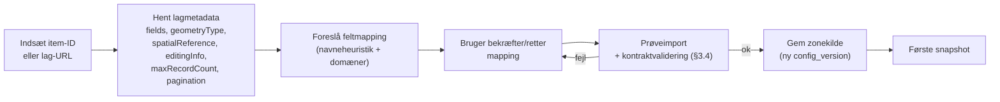
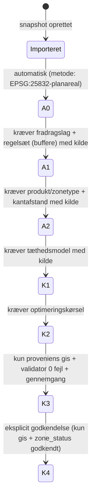
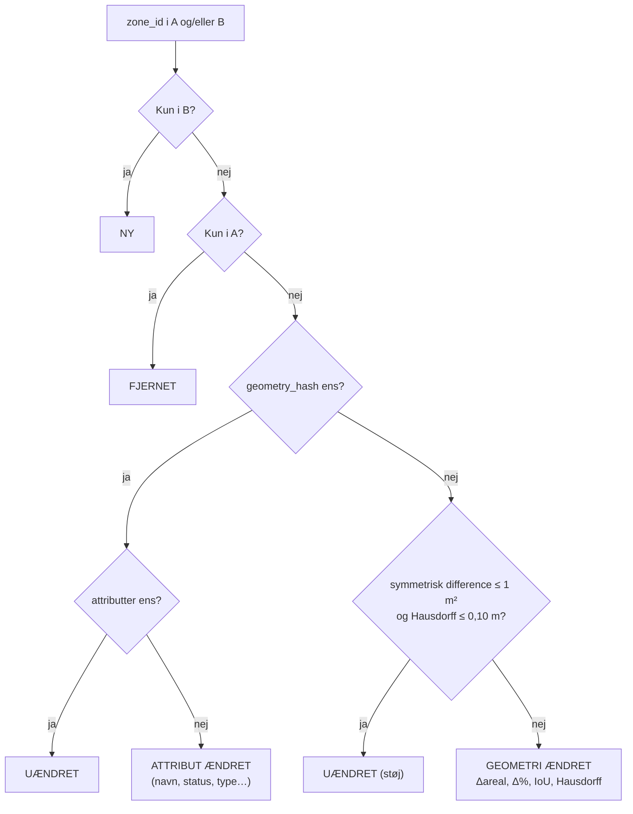

# Discovery 7 — Zoneintegration, datakontrakt og snapshots

> Status: discovery (ingen implementering, ingen ændringer i ArcGIS eller produktion) · Dato: 2026-11-07
> Baggrund: Årets campingzoner leveres som polygoner i et separat ArcGIS-lag, der opdateres hvert festivalår. For RF27 findes zonerne endnu kun som foreløbige skitser i PowerPoint. Der er ingen autoritativ geometri og intet endeligt layer-ID.
> Relaterede dokumenter: [Geometri og kapacitet](DISCOVERY-GEOMETRY-AND-CAPACITY.md) · [Arkitektur](DISCOVERY-ARCHITECTURE.md) · [Roadmap](DISCOVERY-ROADMAP.md)

## 1. Resumé

1. **Zonekilden er konfiguration, ikke kode.** En *zonekilde* pr. festivalår beskriver, hvor zonerne ligger (portal-item eller lag-URL, filter, feltmapping). Et nyt år kræver en ny konfiguration, der kan oprettes og valideres i appen, men ingen kodeændring.
2. **En minimal datakontrakt** med fem obligatoriske elementer: `zone_id`, `zone_name`, `festival_year`, `zone_status` og geometri. Alt, der kan beregnes (areal, centroid, hash, gyldighed, ændringer), *beregner appen selv* og stoler ikke på leverede værdier.
3. **Hver import er et immutable snapshot** med indholdshash. Beregninger peger på et snapshot, aldrig på det levende lag. Ændres ArcGIS-laget, ændres historiske tal ikke; appen viser blot, at der findes en nyere version.
4. **Foreløbige zoner er en separat proveniensklasse.** De kan bruges til estimater, men kan aldrig blive godkendt, aldrig eksporteres som godkendte og aldrig blandes ubemærket med GIS-zoner.
5. **Bruttoareal (A0) beregnes straks ved import.** Disponibelt areal og kapacitet kræver et eksplicit, kildehenvist forudsætningssæt. Uden det vises "mangler forudsætning", aldrig en standardværdi.
6. **Ændringsdetektion** klassificerer hver zone mellem to snapshots som ny, fjernet, uændret, attributændret eller geometrisk ændret, med målte størrelser (Δareal, IoU, Hausdorff) og en støjtolerance.
7. **Kravene til Team GIS** (§9) bør sendes, før zonelaget etableres. De er billigere at aftale nu end at reparere bagefter.

## 2. Konfigurerbar zonekilde

### 2.1 Begreber

| Begreb | Betydning |
|---|---|
| **Zonekilde** (`ZoneSource`) | Versioneret konfiguration: hvor og hvordan et festivalårs zoner hentes |
| **Zonesæt-snapshot** (`ZoneSet`) | Én immutable import fra en zonekilde på et bestemt tidspunkt |
| **Proveniensklasse** | `gis` (autoritativ GIS-kilde) eller `foreloebig` (tegnet, skitse, test) |

### 2.2 Kildetyper

| Type | Brug |
|---|---|
| `arcgis-item` | **Foretrukket.** Portal-item-ID + lagindeks. Robust over for ændrede service-URL'er; URL'en slås op via `/sharing/rest/content/items/{id}` |
| `arcgis-layer-url` | Direkte FeatureServer-lag-URL, når der ikke er et item |
| `geojson-file` | Fil, der overholder samme datakontrakt (fx digitaliserede skitser eller eksport fra GIS) |
| `drawn` | Tegnet i appen. Altid proveniensklasse `foreloebig` |

### 2.3 Eksempel på konfiguration

```json
{
  "schema": "zone-source/v1",
  "source_id": "rf27-zoner",
  "festival_year": 2027,
  "provenance": "gis",
  "type": "arcgis-item",
  "portal": "https://maps.roskilde-festival.dk/portal",
  "item_id": "<udfyldes når GIS har oprettet laget>",
  "layer_index": 0,
  "where": "festival_year = 2027",
  "field_map": {
    "zone_id": "ZONE_ID",
    "zone_name": "NAVN",
    "festival_year": "FESTIVAL_AAR",
    "zone_status": "STATUS",
    "area_group": "OMRAADE",
    "zone_type": "ZONETYPE",
    "predecessor_ids": "FORGAENGER_ID"
  },
  "status_map": { "1": "kladde", "2": "foreloebig", "3": "til_godkendelse", "4": "godkendt", "9": "udgaaet" },
  "expected_wkid": 25832,
  "include_statuses": ["foreloebig", "til_godkendelse", "godkendt"],
  "config_version": 3,
  "changed_by": "…",
  "changed_at": "…"
}
```

`field_map` og `status_map` gør appen uafhængig af GIS' feltnavne og domænekoder. `where` gør det ligegyldigt, om GIS laver ét lag pr. år eller ét lag for alle år.

### 2.4 Oprettelse af en ny zonekilde uden kodeændring



- Konfigurationen gemmes versioneret: først som JSON-fil i repo eller lokalt, senere i D1 (fase 4 i [Roadmap](DISCOVERY-ROADMAP.md)).
- Hvert snapshot registrerer den `config_version`, der blev brugt, så en ændret feltmapping aldrig ændrer betydningen af gamle snapshots.
- Oprettelse og ændring af zonekilder kræver en administratorrolle. Planlæggere vælger blot årets aktive kilde.

### 2.5 Import (teknisk)

- REST `query` med `where`, `outFields` (kun mappede felter), `outSR=25832`, `f=json` og paging (`resultOffset`/`resultRecordCount`) op til lagets `maxRecordCount`. Det er uafhængigt af kortudsnittet og retter fejl F13.
- Hvis lagets `spatialReference` ikke er 25832, reprojiceres der, og det noteres i snapshot-metadata.
- `editingInfo.lastEditDate` gemmes på snapshottet og bruges til ændringsdetektion på lagniveau (§7.1).
- Læsning kræver kun læserettighed. Appen skriver aldrig til zonelaget.

## 3. Minimal datakontrakt for zoner

### 3.1 Skal leveres af GIS

| Felt | Type | Regel | Hvorfor |
|---|---|---|---|
| `zone_id` | Tekst, ≤ 32 tegn, ASCII | Unik inden for `festival_year`. **Stabil på tværs af år** for "samme zone" (§3.3). Aldrig OBJECTID eller GlobalID. Genbruges aldrig for et andet område | Nøgle for snapshots, ændringsdetektion og år-sammenligning |
| `zone_name` | Tekst | Visningsnavn, fx "Camping West B". Må ændres uden at ID ændres | Visning |
| `festival_year` | Heltal | Fx `2027` | Filtrering og sammenligning |
| `zone_status` | Kodet domæne | `kladde`, `foreloebig`, `til_godkendelse`, `godkendt`, `udgaaet` | Afgør, hvad tal må bruges til (§5) |
| Geometri | Polygon (multipart tilladt) | EPSG:25832, gyldig (ingen selvskæring), uden Z/M, ingen overlap med andre zoner samme år | Grundlag for A0 |

### 3.2 Anbefalet fra GIS (stærkt ønsket, ikke blokerende)

| Felt | Formål |
|---|---|
| `area_group` | Område (fx East/West/South), som overblikket grupperer efter |
| `zone_type` | Fx `optegnet`, `fri_camping`, `special`. Afgør tæthedsmodel ([Geometri §3](DISCOVERY-GEOMETRY-AND-CAPACITY.md)) |
| `planned_product_id` | Planlagt produkt, med samme ID som `products.yml` (fx `get_a_place`). Kan også tildeles i appen |
| `predecessor_ids` | Kommasepareret liste af `zone_id` fra forrige år ved opdeling, sammenlægning eller nyt ID |
| `geometry_precision` | `skitse`, `digitaliseret` eller `opmaalt`: hvor præcis geometrien er |
| `status_changed_by` / `status_changed_at` | Hvem satte status, og hvornår (især `godkendt`) |
| Editor tracking | `created_user`/`created_date`/`last_edited_user`/`last_edited_date` (ArcGIS-standard) |
| `note` | Fri kommentar |

### 3.3 Hvad betyder "samme zone"?

Zoneidentitet er en **organisatorisk beslutning** (samme driftsenhed eller campingområde), ikke en geometrisk. GIS eller byplan bestemmer den. Appen kontrollerer kun plausibiliteten:

| Situation | Regel |
|---|---|
| Grænsen justeres | Samme `zone_id` |
| Zonen opdeles i to | Nye ID'er for begge dele, begge med `predecessor_ids = <gammelt ID>`. Alternativt beholder den ene del ID'et efter aftale |
| To zoner lægges sammen | Nyt ID med begge gamle i `predecessor_ids` |
| Zonen flyttes til et helt andet sted | Nyt ID |
| Zonen nedlægges | Optræder ikke i det nye års sæt (eller status `udgaaet`) |

### 3.4 Hvad appen udleder selv (og ikke stoler på fra GIS)

| Udledt værdi | Metode | Bemærkning |
|---|---|---|
| Areal (m², ha), omkreds | Beregnet i EPSG:25832 | `Shape__Area` bruges kun som kontroltal (afvigelse > 0,1 % giver en advarsel, jf. H6) |
| Gyldighed | Validering + rapport | Ugyldig geometri importeres, men markeres. Den rettes aldrig stille |
| Geometrihash | SHA-256 af normaliseret geometri (§6.2) | Ændringsdetektion |
| Centroid, bbox, kantretninger | Beregnet | Overblik og kandidatvinkler til optimering |
| Topologi (overlap, gab, slivers) mellem zoner | Beregnet | [Geometri §5](DISCOVERY-GEOMETRY-AND-CAPACITY.md) |
| Ændringsklasse mod forrige snapshot | §7 | — |
| Forslag til `area_group` | Spatial join mod områdepolygoner, hvis de findes | Kun forslag; skal bekræftes |
| Forslag til forgænger (andet år) | Overlap/IoU mod forrige års snapshot | Kun forslag; skal bekræftes, hvis `predecessor_ids` mangler |

**Kan ikke udledes, og skal leveres eller besluttes:** `zone_id`'s stabilitet, zonens status, zonetype og planlagt produkt (kan sættes i appen, men ejeren skal være klar), og identitet ved opdeling eller sammenlægning.

### 3.5 Kontraktvalidering ved import

| Niveau | Eksempler | Konsekvens |
|---|---|---|
| **Fejl** (blokerer import) | Manglende obligatorisk felt i mapping, ikke-polygon geometri, tomt resultat, dublet-`zone_id` inden for året, `festival_year` ≠ konfigurationens år | Intet snapshot |
| **Advarsel** (importeres, markeres) | Ugyldig geometri, overlap mellem zoner, gab < 0,5 m, `Shape__Area`-afvigelse, ukendt statuskode, `zone_id` der tidligere har dækket et helt andet område (IoU ≈ 0 mod forrige snapshot) | Synligt i datakvalitetslisten |
| **Info** | Nye felter i laget, ændret `lastEditDate`, multipart-zoner | Logges |

## 4. Proveniens: GIS-zoner og foreløbige zoner

### 4.1 Regler for adskillelse

| Regel | GIS (`gis`) | Foreløbig (`foreloebig`) |
|---|---|---|
| Kilde | Konfigureret autoritativ zonekilde | Tegnet i appen, GeoJSON-fil, digitaliseret skitse |
| ID-rum | GIS' `zone_id` | Automatisk præfiks `TMP-` (fx `TMP-WEST-1`). Kan ikke kollidere med GIS-ID'er. Syntetiske testzoner (prototype) får proveniens `syntetisk` og præfiks `SYN-` og følger samme regler som foreløbige |
| Højeste kapacitetsstatus | Godkendt (K4) | **Estimat eller Beregnet.** Aldrig Valideret eller Godkendt |
| Skrivning til ArcGIS | **Aldrig** (A9: ArcGIS er read-only) | **Aldrig** |
| Visuelt | Normal udfyldning | Skraveret udfyldning, stiplet kant, mærket **FORELØBIG** på kort, i tabeller og på hvert tal |
| Eksport (CSV/PDF/GeoJSON) | Normal | Vandmærke "FORELØBIG — ikke GIS-godkendt" + `provenance`-felt på hver række/feature |
| Totaler | — | Altid separat linje: "GIS: 38 zoner · Foreløbig: 6 zoner", aldrig sammenlagt uden opdeling |

Et scenarie *må* kombinere GIS- og foreløbige zoner (realistisk for RF27, hvis nogle zoner kommer før andre), men alle summer opdeles efter proveniens og status.

### 4.2 Overgang fra foreløbig til GIS

En foreløbig zone bliver **aldrig** til en GIS-zone ved omdøbning. Når GIS leverer:

1. GIS-zonesættet importeres som et nyt snapshot.
2. Appen matcher foreløbige zoner mod GIS-zoner på overlap (IoU) og viser forskellen: "TMP-WEST-1 → B: +2,3 ha (+11 %), estimat ændret fra ≈ 640 til ≈ 710 pladser".
3. Scenariet flyttes til GIS-snapshottet. De foreløbige beregninger bevares som historik ("planlægningsestimat januar").

### 4.3 RF27 nu: fra PowerPoint-skitse til foreløbige zoner

| Mulighed | Indsats | Nøjagtighed | Anbefaling |
|---|---|---|---|
| A. GIS digitaliserer skitserne direkte i det kommende zonelag med `zone_status = kladde` og `geometry_precision = skitse` | Lav for appen, lidt for GIS | Afhænger af skitsen | **Foretrukket**, fordi laget og kontrakten etableres med det samme, og ID'er kan sættes fra start |
| B. Planlægger tegner zonerne i appen over ortofoto, med skitsen som reference ved siden af | Ingen ny funktionalitet ud over tegning | Afhænger af skitsen | God nødløsning |
| C. Skitsen indlæses som billedoverlay, georefereres med 3–4 kontrolpunkter (affin transformation), og der tegnes ovenpå | Ny funktion (M) | Bedre end B, hvis skitsen er målfast | Kun hvis skitserne er tegnet over et målfast kort. Afklares (U11) |

**Advarsel om nøjagtighed.** PowerPoint-skitser er typisk ikke målfaste. Bruttoareal fra skitsebaserede zoner vises med `≈` og præcisionsmærket "skitse". Appen opfinder ikke en usikkerhedsprocent; en bruger kan angive én eksplicit, og så fremgår den med navn og dato.

## 5. Bruttoareal straks, resten kun med eksplicitte forudsætninger



| Niveau | Hvornår det vises | Hvis forudsætningen mangler |
|---|---|---|
| **A0** bruttoareal | **Straks ved import**. Den eneste "forudsætning" er den faste, dokumenterede beregningsmetode | — |
| A1 disponibelt | Når et regelsæt (fradragstyper, buffere) er valgt for scenariet | "— mangler fradragsregler" |
| A2 optegningsegnet | Når zonen har produkt eller zonetype + kantafstand | "— mangler produkt" |
| K1 estimat | Når tæthedsmodellen har kildehenviste parametre | "— mangler tæthedsnorm" |

Regler:

- **Ingen stille standardværdier.** Den nuværende apps standardprodukt (5×10, 10×2, sti 5 m) bliver et *navngivet parametersæt* med kilde. Det skal vælges aktivt.
- En parameter uden kilde kan bruges, hvis en navngiven bruger markerer den som **"antagelse — ikke verificeret"**. Tal afledt af den får mærket "Estimat (ubekræftede forudsætninger)", og antagelsen står i forudsætningsskuffen og i alle eksporter.
- Godkendelse (K4) kræver, at **alle** forudsætninger har kilde. Antagelser blokerer godkendelse.

### 5.1 To slags godkendelse (arkitekturkrav A2)

| | Godkendelse af GIS-zonegeometri | Godkendelse af kapacitetsberegning |
|---|---|---|
| Hvad godkendes | At zonens grænse er den gældende for festivalåret | At kapacitetstallene for et scenarie er gældende |
| Ejer | Team GIS / byplan | Campingledelse (U8) |
| Hvor det registreres | `zone_status = godkendt` i GIS-laget; læses af appen og fryses i zonesæt-snapshottet | `CapacityApproval` i appen, bundet til ét beregningssnapshot (zonesæt-hash + forudsætninger + motorversion) |
| Kan appen ændre det? | Nej, kun læse | Ja, af en bruger med godkenderrolle |
| Afhængighed | Ingen | Kræver, at alle zoner i snapshottet er proveniens `gis` med `zone_status = godkendt` |
| Ved senere ændring | Nyt zonesæt-snapshot; ændringsdetektion viser forskellen | Den tidligere kapacitetsgodkendelse består uændret, men markeres "zonegrundlag ændret siden godkendelse"; en ny godkendelse kræver et nyt beregningssnapshot |

UI'et viser de to godkendelser som to separate mærker ("Zone: GIS-godkendt 3. feb" og "Kapacitet: godkendt 10. feb, SH"), så de ikke kan forveksles.

## 6. Versionsstyrede snapshots

### 6.1 Indhold af et zonesæt-snapshot

| Del | Indhold |
|---|---|
| Identitet | `zoneset_hash` (SHA-256 af kanonisk indhold), fortløbende `snapshot_no` pr. zonekilde |
| Kilde | `source_id`, `config_version`, item-ID/lag-URL, `where`, lagets `editingInfo.lastEditDate`, lagets `spatialReference` |
| Proveniens | `gis` eller `foreloebig` |
| Tid og person | `imported_at`, `imported_by` |
| Data | Kanonisk GeoJSON (EPSG:25832) med kontraktfelter + pr.-zone `geometry_hash` |
| Afledt | Valideringsrapport, arealer (A0) pr. zone og total, ændringsrapport mod forrige snapshot |
| Motor | `engine_version` for normalisering og arealberegning |

### 6.2 Kanonisk normalisering (forudsætning for stabile hashes)

For at den samme geometri altid giver samme hash, også efter reprojektion eller GIS' omlagring. Præcisionsværdierne nedenfor (1 cm, tolerancer) er **startforslag, der testes i prototypetrin P2** (arkitekturkrav A4), før de låses:

1. Reprojicér til EPSG:25832.
2. Afrund koordinater til 1 cm.
3. Fjern dublet-punkter og kollineære punkter under tolerance.
4. Orientér ringe ens (ydre mod uret, huller med uret, som RFC 7946).
5. Lad hver ring starte i det leksikografisk mindste punkt.
6. Sortér polygondele og huller deterministisk.
7. Serialisér kanonisk JSON (sorterede nøgler, faste decimaler).
8. Beregn SHA-256: pr. zone (geometri) og for hele sættet (alle zoner sorteret på `zone_id` inkl. attributter).

### 6.3 Regler

- **Snapshots er immutable.** En genimport giver altid et nyt snapshot. Hvis hashen er identisk med det seneste, registreres kun "uændret, kontrolleret <tidspunkt>".
- **Beregninger, scenarier og godkendelser refererer til `zoneset_hash`**, aldrig til zonekilden eller det levende lag.
- Hvis det levende lag har en nyere `lastEditDate` end scenariets snapshot, viser appen: "Zonelaget er ændret siden snapshot 7 (3. feb). Importér og se ændringer?" Den skifter aldrig automatisk.
- Snapshots, der indgår i en godkendelse eller eksport, kan ikke slettes.
- Lagring: fase 2 lokalt (IndexedDB + download/upload af snapshot-fil); fase 4 R2 (indhold) + D1 (metadata), jf. [Arkitektur §3](DISCOVERY-ARCHITECTURE.md).
- Appens snapshots gør historikken **uafhængig af ArcGIS**. Hvis GIS bruger archiving eller versionering i en enterprise geodatabase, er det en fordel, men ikke en forudsætning.

## 7. Ændringsdetektion

### 7.1 Niveauer

| Niveau | Signal | Formål |
|---|---|---|
| Lag | `editingInfo.lastEditDate` > snapshottets | Billig opdagelse af, at "noget er ændret" (banner) |
| Sæt | `zoneset_hash` forskellig | Bekræfter reel ændring |
| Zone | Sammenligning pr. `zone_id` | Hvad, hvor og hvor meget |

### 7.2 Klassifikation pr. zone (snapshot A → B, samme festivalår)



Tolerancerne (1 m², 0,10 m) er **foreslåede startværdier**, ikke dokumenterede krav. De skal være konfigurerbare og aftales med GIS.

### 7.3 Målinger på ændrede zoner

| Mål | Betydning |
|---|---|
| Δareal (m², ha, %) | Påvirker A0 direkte |
| Tilført / fraført areal | Arealet i B∖A og A∖B. Vises på kortet (grøn/rød) |
| IoU | 1 = identisk. Lav IoU med samme ID tyder på ID-genbrug |
| Hausdorff-afstand | Største forskydning af grænsen |
| Afledt kapacitetseffekt | ΔA0 × tæthed som estimat; layouts markeres "forældet" |

### 7.4 Anomalier og identitetsproblemer

| Mønster | Tolkning | Handling |
|---|---|---|
| Samme `zone_id`, IoU < 0,1 | Sandsynlig genbrug af ID for et andet område | Advarsel; bed GIS om at bekræfte |
| Forskellige ID'er, IoU > 0,9 | Sandsynligt nyt ID for samme zone | Forslag: "B2 ligner B (IoU 0,96)" |
| Én zone i A overlapper flere i B betydeligt | Opdeling | Foreslå `predecessor_ids`, hvis de mangler |
| Flere i A overlapper én i B | Sammenlægning | Som ovenfor |
| Status ændret fra `godkendt` | Godkendt zone redigeret | Fremhævet advarsel; tidligere godkendte beregninger forbliver uændrede, men markeres "zonen er siden ændret" |

### 7.5 Mellem festivalår

Samme mekanisme, men matchningen sker på `zone_id` + `predecessor_ids` og, som fallback, på overlap. Forslag fra overlap skal bekræftes, før de bruges i år-sammenligningen ([Geometri §10](DISCOVERY-GEOMETRY-AND-CAPACITY.md)).

### 7.6 Præsentation

- Ændringsrapport ved hver import: "3 nye · 1 fjernet · 5 geometri ændret (+1,8 ha netto) · 2 attributændringer · 29 uændrede".
- Kort i sammenligningstilstand: nye (grøn kant), fjernede (rød stiplet), ændrede (orange) med tilført/fraført areal udfyldt.
- Påvirkede beregninger listes: "Scenarie 'RF27 basis' bygger på snapshot 6, og 5 af dets zoner er ændret i snapshot 7."

## 8. Hvordan det passer ind i resten

| Område | Konsekvens |
|---|---|
| [Geometri](DISCOVERY-GEOMETRY-AND-CAPACITY.md) | Normaliseringspipelinen (§5.1) kører på hvert snapshot. D1 (autoritativt lag) er nu konkretiseret som datakontrakten her |
| [Arkitektur](DISCOVERY-ARCHITECTURE.md) | `ZONESET` og `ZONE` i datamodellen udvides med `provenance`, `source_id`, `config_version`, `zoneset_hash` og `geometry_hash`. Nyt begreb `ZONE_SOURCE` |
| [UX](DISCOVERY-UX-CONCEPTS.md) | BR1 ("Zonerne er landet") bygger på §2.5 og §7: banner ved ændret lag, ændringsrapport, FORELØBIG-mærkning |
| [Roadmap](DISCOVERY-ROADMAP.md) | Zonekilde, kontraktvalidering, snapshots, proveniens og ændringsdetektion hører til fase 2. Kravene til GIS (§9) bør sendes nu |

## 9. Krav til Team GIS, før zonelaget etableres

Forslag til en kort kravspecifikation, der kan sendes til Team GIS. Punkterne markeret **SKAL** er nødvendige for, at appen kan bruge laget uden kodeændringer; **BØR** er stærkt ønsket.

### Lag og adgang

1. **SKAL:** Ét dedikeret zonelag (hosted feature layer eller tilsvarende), adskilt fra felt-/layoutlag. Enten ét lag pr. festivalår eller ét fælles lag med `festival_year`. Valget meddeles.
2. **SKAL:** Portal-item-ID og lagindeks oplyses, så snart laget findes, også mens det kun indeholder kladder.
3. **SKAL:** Læseadgang for appens brugere via en portalgruppe. Appen har **ingen** skriveadgang til zonelaget.
4. **BØR:** Portalens `allowedOrigins` (CORS) inkluderer appens domæner, så der ikke er brug for en proxy (H5).
5. **BØR:** Et testlag med samme skema til integrationstest, adskilt fra produktion.

### Skema

6. **SKAL:** Felterne `zone_id`, `zone_name`, `festival_year` og `zone_status` (kodet domæne med værdierne i §3.1) — eller tilsvarende felter, hvis navne meddeles (mapping i §2.3).
7. **SKAL:** Skemaet holdes stabilt fra år til år. Ændringer varsles.
8. **BØR:** Felterne i §3.2 (`area_group`, `zone_type`, `planned_product_id`, `predecessor_ids`, `geometry_precision`, status-ansvar), samt editor tracking slået til.
9. **BØR:** ASCII-feltnavne uden mellemrum; kodede domæner frem for fritekst for status og type.

### Identitet

10. **SKAL:** `zone_id` er unik pr. år, stabil for samme zone på tværs af år, og genbruges aldrig for et andet område (regler i §3.3).
11. **SKAL:** Ved opdeling eller sammenlægning udfyldes `predecessor_ids`.

### Geometri

12. **SKAL:** EPSG:25832, polygoner, ingen Z/M-værdier.
13. **SKAL:** Gyldig geometri (fx kontrolleret med *Check Geometry* i ArcGIS Pro), før status sættes til `godkendt`.
14. **SKAL:** Ingen overlap mellem zoner i samme år. Fælles grænser snappes, så der ikke opstår gab eller slivers.
15. **BØR:** Én feature pr. zone. Multipart kun, hvor en zone reelt består af adskilte dele.
16. **BØR:** Skitseprægede zoner markeres med `geometry_precision = skitse`.

### Livscyklus

17. **SKAL:** `zone_status = godkendt` sættes kun af den ansvarlige for byplan/GIS (navngives), og ændringer af godkendte zoner kommunikeres.
18. **BØR:** Udgåede zoner sættes til `udgaaet` frem for at blive slettet, inden for et festivalår.
19. **BØR:** Fradragslag (veje, brandveje, infrastruktur) følger en tilsvarende kontrakt (ID, type, år, status, geometri), så A1 kan beregnes uden manuel tegning (U2).
20. **BØR:** En kontaktperson og en forventet tidsplan (hvornår kladder, hvornår godkendte zoner for RF27).

## 10. Nye ukendte forhold og hypoteser

| # | Spørgsmål / hypotese | Hvem |
|---|---|---|
| U11 | Er RF27-skitserne i PowerPoint tegnet over et målfast kort (relevant for mulighed C i §4.3)? | Planlægning |
| U12 | Foretrækker GIS ét lag pr. år eller ét fælles lag med `festival_year`? | Team GIS |
| U13 | Har GIS kapacitet til at digitalisere RF27-skitserne som kladder nu (mulighed A)? | Team GIS |
| U14 | Kan ID-konventionen bygge på de eksisterende områdebogstaver (B, C, L, N, P …), eller skal der laves nye, neutrale ID'er? | Team GIS / camping |
| H9 | Kontraktvalidering + feltmapping gør, at et nyt års lag kan tages i brug på < 15 min uden kodeændring | Test med et testlag efter kontrakten |
| H10 | Kanonisk normalisering giver identisk `geometry_hash` ved genimport af et uændret lag (0 falske ændringer) og ved reprojektion WGS84 ↔ 25832 | Test på RF26-zoner |
| H11 | Støjtolerancen (1 m² / 0,10 m) adskiller digitaliseringsstøj fra reelle ændringer på historiske redigeringer | Test på RF26-redigeringshistorik, hvis tilgængelig |
